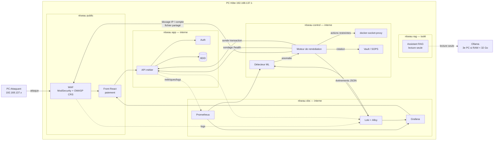

# Architecture — PROJECT RESILIENCE-ALPHA

> Version initiale du lundi 19/10, mise à jour le mardi 20/10 (WAF, détection de crash, blocage par compte) — à valider par l'équipe. Source de vérité des règles : [`CLAUDE.md`](../../CLAUDE.md).

## 1. Vue d'ensemble

## 2. Services

| Service | Rôle | Réseaux | Publié ? | Propriétaire |
|---|---|---|---|---|
| `waf` | ModSecurity + OWASP CRS (nginx), niveau de paranoïa 1 ; refuse les sources de la liste de blocage (njs) ; journal d'audit JSON vers Loki | `resilience-net` | **oui**, `127.0.0.1:8080` (seul point d'entrée) | Hugo |
| `frontend` | Front paiement (le dashboard de supervision est Grafana, pile d'observabilité) | public, app | via WAF | Gabriel |
| `api` | API métier (transactions) | app | non | Antoine |
| `auth` | Authentification / JWT (inscription, connexion) | app, db | non | Antoine |
| `gateway` | Caddy : sert le front, route `/auth/*` → `auth` et `/me/*` → `api`. Placée derrière le WAF | app | non (joignable par le WAF seulement) | Gabriel / Hugo |
| `db` | Base de données (fictive) | app | non | Antoine |
| `prometheus`, `loki`, `grafana` | Métriques, logs, SOC | obs | non (Grafana via WAF) | Hugo |
| `anomaly-detector` | ML (IsolationForest) sur métriques/logs | obs, control | non | Kevin |
| `remediation` | Décision, actions, vérification ; sondage de santé (crash) ; écrit la liste de blocage du WAF | control, app, obs | non | Kevin |
| `docker-proxy-ctl` | Passerelle Docker du moteur : redémarrage/arrêt d'un conteneur existant uniquement | control | non | Hugo |
| `docker-proxy` | Passerelle Docker d'Alloy : lecture seule (`GET /containers`, `/networks`) | pile obs | non | Hugo |
| `vault` | Secrets | control | non | Hugo |
| `rag-assistant` | Assistant RAG (LangChain ; modèle Ollama ≤ 8B hébergé hors Compose) | rag | non (interrogé par `docker compose exec`) | François |

**Règle d'exposition** : seul le WAF publie un port pour le trafic applicatif (Grafana reste lié à `127.0.0.1:3000` tant qu'il n'est pas servi via le WAF sur `192.168.137.1`). Aucun composant, hors les deux passerelles `docker-proxy-ctl` et `docker-proxy`, ne touche `docker.sock`.

### Réseaux Docker implémentés

Le schéma de la section 1 est logique. Dans les fichiers Compose, il se traduit ainsi :

| Réseau Docker | `internal` | Membres | Rôle |
|---|---|---|---|
| `resilience-net` | non | `waf`, `api`, `auth`, `gateway`, `remediation`, `prometheus`, `grafana` | trafic entre services ; aucun port publié |
| `resilience-db-internal` | oui | `postgres`, `migrate`, `api`, `auth` | accès à la base, `api` et `auth` font le lien (rôle `app_rw`) |
| `resilience-control-internal` | oui | `remediation`, `docker-proxy-ctl` | le moteur et sa passerelle, rien d'autre |
| `resilience-obs-internal` | oui | `prometheus`, `loki`, `alloy`, `grafana` | observabilité |
| `resilience-docker-proxy-net` | oui | `alloy`, `docker-proxy` | lecture des logs Docker |
| `resilience-rag` | non | `rag-assistant` | seul membre : aucun chemin vers l'API, la base, le moteur ni Docker. Non `internal`, car Ollama est hors de Docker (PC hôte ou 3e PC) |

La collecte des logs est faite par **Alloy** (et non Promtail). `infra/compose/docker-compose.yml` (socle) et `docker-compose.observability.yml` sont deux piles autonomes, à ne pas fusionner par `-f` multiples.

## 3. Moteur de remédiation

```mermaid
flowchart LR
    D[Detector<br/>ML] -->|Anomaly| I[Incident]
    I --> P[DecisionPolicy]
    P -->|RemediationAction&#91;&#93;| A[Actions]
    A --> V[RecoveryVerifier]
    V -->|API saine ET transaction OK| C[Incident clos]
    V -->|échec| P
    D -.event.-> E[(EventPublisher<br/>JSON → Loki → dashboard Grafana)]
    P -.event.-> E
    A -.event.-> E
    V -.event.-> E
```

### Disponibilité ≠ compromission

| Type d'incident | Exemple | Actions (dans l'ordre) |
|---|---|---|
| `AVAILABILITY` | flood HTTP | `BlockIpAction` → `BlockSubjectAction` → `RestartServiceAction` → (`ScaleServiceAction`) |
| `CRASH` | conteneur arrêté (S3) | `RestartServiceAction` seule |
| `DATABASE_CORRUPTION` | altération/corruption BDD (S4) | `RestoreDatabaseAction` → `RestartServiceAction` → vérification transactionnelle |
| `COMPROMISE` | SQLi, exfiltration | cible : `BlockIpAction` → `RotateSecretAction` → investigation ; **non câblé** dans `main.py` tant que `VaultSecretRotator` n'existe pas. Une restauration S4 ne suffit pas |

### Ports (`services/remediation/app/domain/ports.py`)

| Port | Rôle | Implémentation prod | Implémentation test |
|---|---|---|---|
| `Detector` | produit une `Anomaly` | `MlDetector` (modèle chargé) | `FakeDetector` |
| `DecisionPolicy` | `Incident` → actions | `KindBasedPolicy` | — |
| `RemediationAction` | exécute une action | `BlockIpAction`, `RestartServiceAction`… | fakes |
| `RecoveryVerifier` | prouve la reprise | `HealthAndProbeVerifier` | — |
| `ContainerRestarter` | redémarre un conteneur | `DockerProxyClient` | `FakeDockerClient` |
| `DatabaseRestorer` | restaure la dernière archive validée antérieure à la détection | `HttpDatabaseRestorer` (service privé `db-recovery`, `PROBE_TOKEN`) | fake |
| `ServiceScaler` | change les replicas | `DockerProxyClient` | `FakeDockerClient` |
| `IpBlocker` | bloque/débloque une IP | `IpBlocklist` (fichier lu par le WAF) | `FakeIpBlocker` |
| `SubjectBlocker` | bloque/débloque un compte (`sub`) | `SubjectBlocklist` (même fichier) | fake |
| `SecretRotator` | rotation de secret | `VaultSecretRotator` | `FakeSecretRotator` |
| `HealthChecker` | santé d'un service | `HttpHealthChecker` | `FakeHealthChecker` |
| `TransactionProbe` | transaction de test | `ApiTransactionProbe` | `FakeProbe` |
| `EventPublisher` | événement JSON | `JsonStdoutPublisher` | `InMemoryPublisher` |

Extensibilité (OCP) : nouvelle action ou nouveau détecteur = nouvelle classe enregistrée dans le registre, sans modifier l'existant.

### Détection de crash (S3)

Une panne binaire ne passe pas par le ML. `HealthWatchDetector` sonde `GET /health` ; après 3 échecs consécutifs il produit une `Anomaly` de type `CRASH`. La politique associe à `CRASH` la seule `RestartServiceAction`, car `block_ip` / `block_subject` échoueraient sans attaquant. Le pipeline traite un seul incident à la fois (verrou), pour qu'un flood et un crash simultanés ne provoquent pas deux redémarrages concurrents. La vérification reste la même : API saine ET transaction de test réussie.

### Blocage de la source : IP et compte

Le moteur écrit `ip:<adresse>` ou `sub:<id>` dans `blocked.txt`, fichier d'un volume partagé (écriture atomique). Le WAF le monte en lecture seule et le relit à chaque requête via njs (`infra/waf/njs/blocklist.js`) ; aucun rechargement nginx, aucun accès Docker de plus pour le moteur.

Sous Docker Desktop, le WAF voit l'IP de la passerelle Docker (172.x) et non celle de l'attaquant : bloquer l'IP couperait tout le monde. Le moteur bloque donc aussi le **compte** (`sub` du JWT, port `SubjectBlocker`, `BlockSubjectAction`). Le détecteur désigne le compte dominant d'après le journal d'accès du WAF dans Loki. La signature du jeton n'est pas vérifiée par njs (l'API le fait) : une revendication falsifiée ne peut qu'être bloquée, jamais autorisée. Limite : un attaquant peut créer d'autres comptes ; l'IP reste exploitable sur un hôte Linux. Arbitrage consigné dans `06-pilotage-arbitrages.md` (à valider avec Hugo).

### Événements structurés

Chaque étape émet un JSON : `{"service","trace_id","event","incident_id","at","data":{…}}`.
Événements : `incident.detected`, `decision.made`, `action.executed`, `verification.completed`, `incident.resolved` / `incident.failed`.

## 4. Contrats entre services (à figer mardi)

| Appelant → appelé | Endpoint | Usage |
|---|---|---|
| remediation → api | `GET /health` | `HealthChecker` |
| remediation → api | `POST /transactions` (compte de test fictif) | `TransactionProbe` |
| detector → prometheus | `/api/v1/query_range` | features ML (débit, latence, taux d'erreur) |
| detector → loki | `/loki/api/v1/query_range` | features ML (logs WAF) et compte dominant d'une attaque |
| detector → remediation | `POST /incidents` (token) | remontée d'anomalie |
| remediation → docker-socket-proxy | restart / scale uniquement | `ContainerRestarter`, `ServiceScaler` |
| remediation → waf | fichier `blocked.txt` (volume partagé, lecture seule côté WAF) | `IpBlocker`, `SubjectBlocker` |
| Grafana → remediation (optionnel) | `GET /incidents` (liste, plus récents d'abord) et `GET /incidents/{id}`, protégés par jeton ; le flux d'événements passe par Loki | affichage avant / pendant / après |

## 5. Sécurité & RAM

- Secrets : Vault ou SOPS, `.env` ignoré, `.env.example` fourni.
- `mem_limit` sur chaque conteneur (PC Hôte 16 Go) ; Ollama sur un 3e PC si < 32 Go.
- Le RAG n'a aucun accès au moteur de remédiation ni à Docker.
- Reset d'état : `scripts/reset_demo.sh` (débloque les IP, restaure la BDD) pour ≥ 5 passages.

## 6. Questions ouvertes

- WAF : ModSecurity + CRS et liste de blocage par fichier retenus le 20/10 ; à valider avec Hugo.
- Transport détecteur → remédiation : HTTP direct sur `POST /incidents` (en place).
- Wazuh ou fonction SOC Loki/Grafana seule, selon la RAM (Hugo).
- Exposer Grafana et le front via le WAF sur `192.168.137.1` (aujourd'hui `127.0.0.1`).
