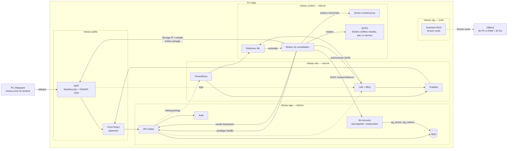

# Architecture — PROJECT RESILIENCE-ALPHA

> Version initiale du lundi 19/10, mise à jour le mardi 20/10 (WAF, détection de crash, blocage par compte) — à valider par l'équipe. Source de vérité des règles : [`CLAUDE.md`](../../CLAUDE.md).

## 1. Vue d'ensemble

## 2. Services

| Service | Rôle | Réseaux | Publié ? | Propriétaire |
|---|---|---|---|---|
| `waf` | ModSecurity + OWASP CRS (nginx), niveau de paranoïa 1 ; refuse les sources de la liste de blocage (njs) ; journal d'audit JSON vers Loki | `resilience-net` | **oui**, `${WAF_BIND_HOST:-127.0.0.1}:8080` (seul point d'entrée ; `127.0.0.1` par défaut, IP LAN du PC Hôte sur le réseau privé du binôme — hotspot ou box — en essai réel) | Hugo |
| `gateway` | Caddy : build multi-étapes qui embarque le front React (`frontend/`) servi en statique, et route `/auth/*` → `auth`, `/me/*` → `api`. Placée derrière le WAF ; aucun conteneur `frontend` séparé | app | non (joignable par le WAF seulement) | Gabriel / Hugo |
| `api` | API métier (transactions) | app | non | Antoine |
| `auth` | Authentification / JWT (inscription, connexion) | app, db | non | Antoine |
| `postgres` | Base de données (fictive) | app | non | Antoine |
| `db-recovery` | Sauvegarde `pg_dump` toutes les 5 min (12 gardées, volume `postgres-backups`) et restauration `pg_restore` ; rôle propriétaire, 128 Mo | db-internal, control-internal | non | Antoine |
| `prometheus`, `loki`, `alloy`, `grafana` | Métriques, logs (Alloy ingère, pas Promtail), SOC | obs | non publié ; servi sous `/grafana` via le WAF puis la passerelle | Hugo |
| `anomaly-detector` | ML (IsolationForest) sur métriques/logs ; invariants du grand livre pour `database_corruption` | obs, control | non | Kevin |
| `remediation` | Décision, actions, vérification ; sondage de santé (crash) ; écrit la liste de blocage du WAF | control, app, obs | non | Kevin |
| `docker-proxy-ctl` | Passerelle Docker du moteur : redémarrage/arrêt d'un conteneur existant uniquement | control | non | Hugo |
| `docker-proxy`, `docker-proxy-autoheal` | Passerelles Docker d'Alloy (lecture seule) et de l'auto-guérison d'Alloy (restart-only, ajoutée le 21/10) ; voir `observabilite.md` §7bis | pile obs | non | Hugo |
| *(pas de service dédié)* | Secrets : **SOPS + age**, tranché le 21/10 (voir `06-pilotage-arbitrages.md`). `infra/secrets/*.enc.yaml` montés en fichiers dans `remediation` ; `RotateSecretAction`/`SopsSecretRotator` implémentée et essayée en réel | — | — | Kevin |
| `rag-assistant` | Assistant RAG (LangChain ; modèle Ollama ≤ 8B hébergé hors Compose) | rag | non (interrogé par `docker compose exec`) | François |

**Règle d'exposition** : seul le WAF publie un port pour le trafic applicatif. Grafana ne publie aucun port : elle est servie sous `/grafana` par le WAF (puis la passerelle), donc soumise aux règles ModSecurity. Aucun composant, hors les passerelles `docker-proxy-ctl`, `docker-proxy` et `docker-proxy-autoheal`, ne touche `docker.sock`.

### Réseaux Docker implémentés

Le schéma de la section 1 est logique. Dans les fichiers Compose, il se traduit ainsi :

| Réseau Docker | `internal` | Membres | Rôle |
|---|---|---|---|
| `resilience-net` | non | `waf`, `api`, `auth`, `gateway`, `remediation`, `prometheus`, `grafana` | trafic entre services ; aucun port publié |
| `resilience-db-internal` | oui | `postgres`, `migrate`, `db-recovery`, `api`, `auth` | accès à la base, `api` et `auth` font le lien (rôle `app_rw`) |
| `resilience-control-internal` | oui | `remediation`, `docker-proxy-ctl`, `db-recovery` | le moteur, sa passerelle Docker et le service de restauration (jeton `PROBE_TOKEN`) |
| `resilience-obs-internal` | oui | `prometheus`, `loki`, `alloy`, `grafana` | observabilité |
| `resilience-docker-proxy-net` | oui | `alloy`, `docker-proxy` | lecture des logs Docker |
| `resilience-rag` | non | `rag-assistant` | seul membre : aucun chemin vers l'API, la base, le moteur ni Docker. Non `internal`, car Ollama est hors de Docker (PC hôte ou 3e PC) |

La collecte des logs est faite par **Alloy** (et non Promtail). `infra/compose/docker-compose.yml` (socle) et `docker-compose.observability.yml` sont deux piles autonomes, à ne pas fusionner par `-f` multiples.

## 3. Moteur de remédiation

```mermaid
flowchart LR
    D[Detector<br/>ML] -->|Anomaly| I[Incident]
    I --> P[DecisionPolicy]
    P -->|RemediationAction&#91;&#93;| A[Actions]
    A --> V[RecoveryVerifier]
    V -->|API saine ET transaction OK| C[Incident clos]
    V -->|échec| P
    D -.event.-> E[(EventPublisher<br/>JSON → Loki → dashboard Grafana)]
    P -.event.-> E
    A -.event.-> E
    V -.event.-> E
```

### Disponibilité ≠ compromission

| Type d'incident | Exemple | Actions (dans l'ordre) |
|---|---|---|
| `AVAILABILITY` | flood HTTP | `BlockIpAction` → `BlockSubjectAction` → `RestartServiceAction` → (`ScaleServiceAction`) |
| ↳ détail `BlockIpAction` | — | **Échec attendu, pas un bug.** `DetectionService` (`services/anomaly-detector/app/application/detection.py`) ne renseigne jamais `attacker_ip` : avec Docker Desktop, l'IP de l'attaquant est NATée derrière la gateway avant le WAF, donc toutes les requêtes arrivent sous la même IP (bloquer par IP bloquerait tout le monde). Seul `attacker_subject` (claim `sub` du JWT, via une requête Loki) est renseigné ; `BlockIpAction` échoue donc systématiquement (`aucune IP source identifiée`), loggé en `action.executed` avec `success: false`, et c'est `BlockSubjectAction` qui bloque réellement l'attaquant. Voir l'arbitrage du 20/10 dans `docs/gouvernance/06-pilotage-arbitrages.md`. |
| `CRASH` | conteneur arrêté (S3) | `RestartServiceAction` seule |
| `DATABASE_CORRUPTION` | altération/corruption BDD (S4) | `RestoreDatabaseAction` → `RestartServiceAction` → vérification transactionnelle |
| `COMPROMISE` | SQLi, exfiltration | `RotateSecretAction` (JWT) → `RestartServiceAction(auth)` → `RestartServiceAction(api)` ; câblé dans `main.py`. Pas de `BlockIpAction` : bloquer une IP ne corrige rien ici. Investigation manuelle non automatisée (assumé). Une restauration S4 ne suffit pas |

### Ports (`services/remediation/app/domain/ports.py`)

| Port | Rôle | Implémentation prod | Implémentation test |
|---|---|---|---|
| `Detector` | produit une `Anomaly` | `MlDetector` (modèle chargé) | `FakeDetector` |
| `DecisionPolicy` | `Incident` → actions | `KindBasedPolicy` | — |
| `RemediationAction` | exécute une action | `BlockIpAction`, `RestartServiceAction`… | fakes |
| `RecoveryVerifier` | prouve la reprise | `HealthAndProbeVerifier` | — |
| `ContainerRestarter` | redémarre un conteneur | `DockerProxyClient` | `FakeDockerClient` |
| `DatabaseRestorer` | restaure la dernière archive validée antérieure à la détection | `HttpDatabaseRestorer` (service privé `db-recovery`, `PROBE_TOKEN`) | fake |
| `ServiceScaler` | change les replicas | `DockerProxyClient` | `FakeDockerClient` |
| `IpBlocker` | bloque/débloque une IP | `IpBlocklist` (fichier lu par le WAF) | `FakeIpBlocker` |
| `SubjectBlocker` | bloque/débloque un compte (`sub`) | `SubjectBlocklist` (même fichier) | fake |
| `SecretRotator` | rotation de secret | `SopsSecretRotator` | fake (`SopsRunner` injectable) |
| `HealthChecker` | santé d'un service | `HttpHealthChecker` | `FakeHealthChecker` |
| `TransactionProbe` | transaction de test | `ApiTransactionProbe` | `FakeProbe` |
| `EventPublisher` | événement JSON | `JsonStdoutPublisher` | `InMemoryPublisher` |

Extensibilité (OCP) : nouvelle action ou nouveau détecteur = nouvelle classe enregistrée dans le registre, sans modifier l'existant.

### Détection de crash (S3)

Une panne binaire ne passe pas par le ML. `HealthWatchDetector` sonde `GET /health` ; après 3 échecs consécutifs il produit une `Anomaly` de type `CRASH`. La politique associe à `CRASH` la seule `RestartServiceAction`, car `block_ip` / `block_subject` échoueraient sans attaquant. Le pipeline traite un seul incident à la fois (verrou), pour qu'un flood et un crash simultanés ne provoquent pas deux redémarrages concurrents. La vérification reste la même : API saine ET transaction de test réussie.

### Blocage de la source : IP et compte

Le moteur écrit `ip:<adresse>` ou `sub:<id>` dans `blocked.txt`, fichier d'un volume partagé (écriture atomique). Le WAF le monte en lecture seule et le relit à chaque requête via njs (`infra/waf/njs/blocklist.js`) ; aucun rechargement nginx, aucun accès Docker de plus pour le moteur.

Sous Docker Desktop, le WAF voit l'IP de la passerelle Docker (172.x) et non celle de l'attaquant : bloquer l'IP couperait tout le monde. Le moteur bloque donc aussi le **compte** (`sub` du JWT, port `SubjectBlocker`, `BlockSubjectAction`). Le détecteur désigne le compte dominant d'après le journal d'accès du WAF dans Loki. La signature du jeton n'est pas vérifiée par njs (l'API le fait) : une revendication falsifiée ne peut qu'être bloquée, jamais autorisée. Limite : un attaquant peut créer d'autres comptes ; l'IP reste exploitable sur un hôte Linux. Arbitrage consigné et **validé le 21/10** dans `06-pilotage-arbitrages.md`, reconfirmé par 5 passages réels depuis le PC Attaquant.

### Événements structurés

Chaque étape émet un JSON : `{"service","trace_id","event","incident_id","at","data":{…}}`.
Événements : `incident.detected`, `decision.made`, `action.executed`, `verification.completed`, `incident.resolved` / `incident.failed`.

`db-recovery` émet les siens (`service=db-recovery`) : `database.backup.created` / `.failed`, `database.restore.completed` / `.failed`. Ils arrivent dans Loki avec les autres journaux ; aucun panneau Grafana ne les affiche encore.

## 4. Contrats entre services (à figer mardi)

| Appelant → appelé | Endpoint | Usage |
|---|---|---|
| remediation → api | `GET /health` | `HealthChecker` |
| remediation → api | `POST /transactions` (compte de test fictif) | `TransactionProbe` |
| detector → prometheus | `/api/v1/query_range` | features ML (débit, latence, taux d'erreur) |
| detector → loki | `/loki/api/v1/query_range` | features ML (logs WAF) et compte dominant d'une attaque |
| detector → remediation | `POST /incidents` (token) | remontée d'anomalie |
| anomaly-detector → db-recovery | `GET /integrity` (compteurs, sans jeton ni donnée) | `IntegritySource` |
| remediation → db-recovery | `POST /restore?before=<détection − marge>` (`PROBE_TOKEN`) | `DatabaseRestorer` |
| remediation → docker-socket-proxy | restart / scale uniquement | `ContainerRestarter`, `ServiceScaler` |
| remediation → waf | fichier `blocked.txt` (volume partagé, lecture seule côté WAF) | `IpBlocker`, `SubjectBlocker` |
| Grafana → remediation (optionnel) | `GET /incidents` (liste, plus récents d'abord) et `GET /incidents/{id}`, protégés par jeton ; le flux d'événements passe par Loki | affichage avant / pendant / après |

## 5. Sécurité & RAM

- Secrets : SOPS + age (choix tranché le 21/10, voir `06-pilotage-arbitrages.md`), `.env` ignoré, `.env.example` fourni, `scripts/render_env.sh` pour produire `.env` localement.
- `mem_limit` sur chaque conteneur (PC Hôte 16 Go ; `db-recovery` : 128 Mo) ; Ollama sur un 3e PC si < 32 Go.
- Le RAG n'a aucun accès au moteur de remédiation ni à Docker.
- Reset d'état : `scripts/reset_demo.sh` (débloque les IP, rejoue le schéma et le seed, purge les archives S4 puis sauvegarde l'état propre) pour ≥ 5 passages.

## 5bis. Authentification renforcée du back-office (consigne additionnelle 1, **à implémenter**)

Conception, interprétations à trancher et découpage : [`../consigne-additionnelle-1.md`](../consigne-additionnelle-1.md). Éléments d'architecture, **non encore déployés** :

| Composant | Rôle | Où | Publié ? |
|---|---|---|---|
| `auth` (étendu) | Machine à états identifiant → visage → mot de passe, verrouillage (2 échecs → 5 min), habilitations | Compose, réseaux app/db | non |
| `host-agent/camera` | Ouvre la caméra USB du PC Hôte, détecte et compare le visage (OpenCV YuNet + SFace) ; API locale + jeton | **natif Windows, hors Docker** (Docker Desktop ne voit pas l'USB) | non, joignable par `auth` seulement |
| ESP8266 (`firmware/esp8266-led/`) | LED bicolore, `POST /led` (jeton), WiFi du point d'accès | matériel | non |
| Tables `roles`, `face_templates`, `login_lockouts` | Habilitations, gabarits chiffrés, blocages | BDD | non |

Ports : `FaceVerifier`, `CameraControl`, `StatusLed`, `LockoutStore` ; `RoleStore` (habilitations `admin` / `operator`, en mémoire pour l'instant) ; événements `auth.face.recognized|rejected`, `auth.locked`, `auth.access.denied_no_role`, `auth.admin.role_granted|role_revoked|unlocked|forbidden` vers Loki. Jeton de back-office à audience `backoffice`, distinct du jeton client : l'API métier le refuse. `POST /auth/admin/login` renvoie `{token, identifier, name, role}` ; routes d'administration en GET/POST sous `/auth/admin/*` (le CRS refuse PUT/DELETE). Détail : [`consigne-additionnelle-1.md`](../consigne-additionnelle-1.md) §4. Échec fermé : sans caméra ou agent, pas d'accès.

## 6. Questions ouvertes

- Consigne additionnelle 1 : gel du code, interprétation du « etc. » du blocage, matériel disponible (voir `consigne-additionnelle-1.md` §2 et §8).

- WAF : ModSecurity + CRS et liste de blocage par fichier retenus le 20/10 ; à valider avec Hugo.
- Transport détecteur → remédiation : HTTP direct sur `POST /incidents` (en place).
- ~~Wazuh ou fonction SOC Loki/Grafana seule~~ : Loki/Grafana seuls, tranché le 21/10 (`06-pilotage-arbitrages.md`).
- ~~Exposer Grafana et le front via le WAF sur le réseau privé du binôme~~ fait le 21/10 (`WAF_BIND_HOST`/`GRAFANA_ROOT_URL`, voir `validation-jalon-21-10.md`).
