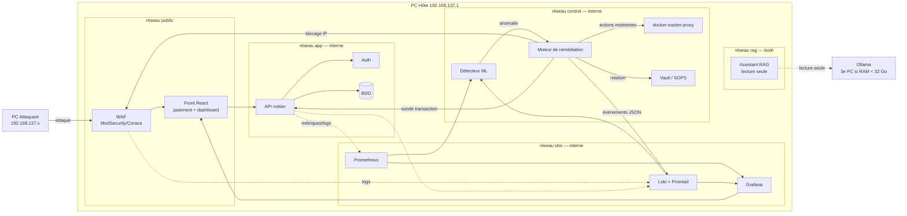

# Architecture — PROJECT RESILIENCE-ALPHA

> Version initiale du lundi 19/10 — à valider par l'équipe. Source de vérité des règles : [`CLAUDE.md`](../../CLAUDE.md).

## 1. Vue d'ensemble

## 2. Services

| Service | Rôle | Réseaux | Publié ? | Propriétaire |
|---|---|---|---|---|
| `waf` | Filtrage, blocage IP, logs d'accès | public, app | **oui** (seul point d'entrée) | Hugo |
| `frontend` | Front paiement + dashboard | public, app | via WAF | Gabriel |
| `api` | API métier (transactions) | app | non | Antoine |
| `auth` | Authentification / JWT | app | non | Antoine |
| `db` | Base de données (fictive) | app | non | Antoine |
| `prometheus`, `loki`, `grafana` | Métriques, logs, SOC | obs | non (Grafana via WAF) | Hugo |
| `anomaly-detector` | ML (IsolationForest) sur métriques/logs | obs, control | non | Kevin |
| `remediation` | Décision, actions, vérification | control, app, obs | non | Kevin |
| `docker-socket-proxy` | Endpoints Docker restreints | control | non | Hugo |
| `vault` | Secrets | control | non | Hugo |
| `rag-assistant` | Assistant RAG (Ollama + LangChain ≤ 8B) | rag | non | François |

**Règle d'exposition** : seul le WAF publie un port. Aucun composant, hors `docker-socket-proxy`, ne touche `docker.sock`.

## 3. Moteur de remédiation

```mermaid
flowchart LR
    D[Detector<br/>ML] -->|Anomaly| I[Incident]
    I --> P[DecisionPolicy]
    P -->|RemediationAction&#91;&#93;| A[Actions]
    A --> V[RecoveryVerifier]
    V -->|API saine ET transaction OK| C[Incident clos]
    V -->|échec| P
    D -.event.-> E[(EventPublisher<br/>JSON → Loki + dashboard)]
    P -.event.-> E
    A -.event.-> E
    V -.event.-> E
```

### Disponibilité ≠ compromission

| Type d'incident | Exemple | Actions (dans l'ordre) |
|---|---|---|
| `AVAILABILITY` | flood HTTP | `BlockIpAction` → `RestartServiceAction` → (`ScaleServiceAction`) |
| `COMPROMISE` | SQLi, exfiltration | `BlockIpAction` → `RotateSecretAction` → investigation (événement dédié) |

### Ports (`services/remediation/app/domain/ports.py`)

| Port | Rôle | Implémentation prod | Implémentation test |
|---|---|---|---|
| `Detector` | produit une `Anomaly` | `MlDetector` (modèle chargé) | `FakeDetector` |
| `DecisionPolicy` | `Incident` → actions | `KindBasedPolicy` | — |
| `RemediationAction` | exécute une action | `BlockIpAction`, `RestartServiceAction`… | fakes |
| `RecoveryVerifier` | prouve la reprise | `HealthAndProbeVerifier` | — |
| `ContainerRestarter` | redémarre un conteneur | `DockerProxyClient` | `FakeDockerClient` |
| `ServiceScaler` | change les replicas | `DockerProxyClient` | `FakeDockerClient` |
| `IpBlocker` | bloque/débloque une IP | `WafIpBlocker` | `FakeIpBlocker` |
| `SecretRotator` | rotation de secret | `VaultSecretRotator` | `FakeSecretRotator` |
| `HealthChecker` | santé d'un service | `HttpHealthChecker` | `FakeHealthChecker` |
| `TransactionProbe` | transaction de test | `ApiTransactionProbe` | `FakeProbe` |
| `EventPublisher` | événement JSON | `JsonStdoutPublisher` | `InMemoryPublisher` |

Extensibilité (OCP) : nouvelle action ou nouveau détecteur = nouvelle classe enregistrée dans le registre, sans modifier l'existant.

### Événements structurés

Chaque étape émet un JSON : `{"service","trace_id","event","incident_id","at","data":{…}}`.
Événements : `incident.detected`, `decision.made`, `action.executed`, `verification.completed`, `incident.resolved` / `incident.failed`.

## 4. Contrats entre services (à figer mardi)

| Appelant → appelé | Endpoint | Usage |
|---|---|---|
| remediation → api | `GET /health` | `HealthChecker` |
| remediation → api | `POST /transactions` (compte de test fictif) | `TransactionProbe` |
| detector → prometheus | `/api/v1/query_range` | features ML (débit, latence, taux d'erreur) |
| detector → loki | `/loki/api/v1/query_range` | features ML (logs WAF) |
| detector → remediation | `POST /incidents` (token) | remontée d'anomalie |
| remediation → docker-socket-proxy | restart / scale uniquement | `ContainerRestarter`, `ServiceScaler` |
| remediation → waf | API restreinte (token) | `IpBlocker` |
| dashboard → remediation | `GET /incidents`, flux d'événements | affichage avant / pendant / après |

## 5. Sécurité & RAM

- Secrets : Vault ou SOPS, `.env` ignoré, `.env.example` fourni.
- `mem_limit` sur chaque conteneur (PC Hôte 16 Go) ; Ollama sur un 3e PC si < 32 Go.
- Le RAG n'a aucun accès au moteur de remédiation ni à Docker.
- Reset d'état : `scripts/reset-demo` (débloque les IP, restaure la BDD) pour ≥ 5 passages.

## 6. Questions ouvertes

- WAF : ModSecurity ou Coraza ? Mécanisme de blocage d'IP (liste dynamique, API) à trancher avec Hugo.
- Transport détecteur → remédiation : HTTP direct ou file ? (proposition : HTTP simple pour mardi).
- Wazuh ou fonction SOC Loki/Grafana seule, selon la RAM.
