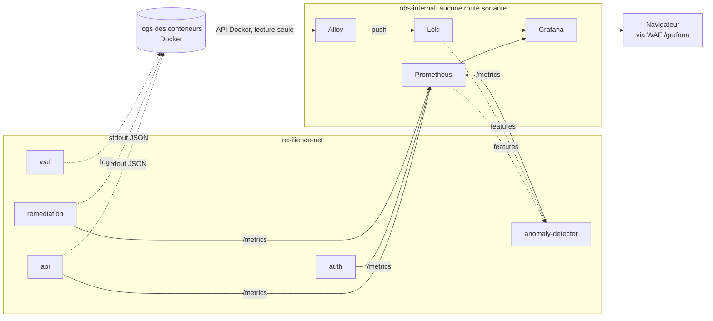

# Observabilité, Prometheus, Loki, Alloy, Grafana

> Source de vérité des règles du projet : [`CLAUDE.md`](../../CLAUDE.md). Vue d'ensemble : [`architecture.md`](architecture.md).

## 1. Rôle

La pile d'observabilité doit rendre l'incident **visible avant, pendant et après**, et montrer le pipeline de remédiation (`détection → décision → action → vérification`). Elle sert trois consommateurs :

1. le **jury**, via un dashboard Grafana unique qui raconte l'incident sans manipulation ;
2. le **détecteur ML**, qui lit les métriques Prometheus et les logs Loki pour construire ses features ;
3. la **fonction SOC**, qui exploite les logs JSON structurés corrélés par `trace_id`.

Un conteneur qui redémarre ne prouve rien : le dashboard affiche donc aussi le résultat de la **transaction de vérification**, qui est la seule preuve de reprise.

## 2. Composants

| Composant | Image épinglée | `mem_limit` | Port interne | Publié ? |
|---|---|---|---|---|
| Prometheus | `prom/prometheus:v3.1.0` | 512 Mo | 9090 | non |
| Loki | `grafana/loki:3.4.2` | 384 Mo | 3100 | non |
| Grafana Alloy | `grafana/alloy:v1.7.1` | 128 Mo | 12345 | non |
| Grafana | `grafana/grafana:11.5.2` | 256 Mo | 3000 | non ; servi sous `/grafana` via le WAF |

Total : **1 280 Mo (1,25 Go)** sur les 16 Go du PC Hôte, + 56 Mo pour `autoheal` et sa passerelle Docker dédiée (§7). Aucune image en `latest` : une démonstration rejouée cinq fois doit tourner sur les mêmes binaires que la veille (`autoheal` fait exception, épinglé par digest, voir §7).

Chaque service a un `healthcheck`, un `restart: unless-stopped`, `cap_drop: ALL`, `no-new-privileges` et une rotation de logs (`max-size: 10m`, `max-file: 3`) pour ne pas remplir le disque pendant un flood.

Fichiers :

```
infra/observability/
  prometheus/prometheus.yml
  loki/loki-config.yml
  alloy/config.alloy
  grafana/provisioning/datasources/datasources.yml
  grafana/provisioning/dashboards/dashboards.yml
  grafana/provisioning/alerting/alert-rules-*.yaml
  grafana/dashboards/resilience-alpha.json
infra/compose/docker-compose.observability.yml
```

## 3. Flux de données



## 4. Exposition réseau

La règle non négociable du projet est respectée : **seul le point d'entrée est publié**.

- `obs-internal` (nom Docker : `resilience-obs-internal`) est déclaré `internal: true` : les conteneurs qui y sont attachés n'ont aucune route vers l'extérieur du PC Hôte.
- **Prometheus, Loki et Alloy ne publient aucun port.** Prometheus est en plus attaché à `resilience-net` parce qu'il doit joindre `api`, `auth`, `remediation` et `anomaly-detector` par leur nom DNS Docker.
- **Grafana** est la seule interface consultable. Elle ne publie aucun port : elle est atteinte sous `/grafana` via le WAF, puis la passerelle Caddy, qui la joint par `resilience-net` (`GF_SERVER_SERVE_FROM_SUB_PATH=true`). Le trafic du dashboard traverse donc ModSecurity.
- Le réseau `resilience-net` appartient à `infra/compose/docker-compose.yml` et est déclaré ici en `external: true`. La pile principale doit donc être démarrée d'abord. Si la pile principale préfixe le nom du réseau par son nom de projet, la variable `RESILIENCE_NET_NAME` permet de pointer le nom réel sans modifier le fichier.

## 5. Métriques

### Contrat d'instrumentation

Prometheus scrape le port **8000**, chemin **`/metrics`**, sur `api`, `auth`, `remediation` et `anomaly-detector`. Le dashboard attend les séries suivantes, qui correspondent aux conventions usuelles d'un instrumentateur FastAPI :

| Série | Type | Labels utilisés |
|---|---|---|
| `http_requests_total` | compteur | `status` (et `method`, `handler`) |
| `http_request_duration_seconds_bucket` | histogramme | `le` (et `method`, `handler`) |

Le label `service` n'est **pas** attendu des applications : il est ajouté par Prometheus cible par cible (`service: api`, `service: auth`, …). Le dashboard fonctionne donc même si une équipe nomme ses métriques autrement, il suffit d'ajuster les requêtes, pas la topologie.

### Cibles absentes

Tous les services sont configurés, y compris ceux qui ne répondent pas encore. C'est volontaire : une cible injoignable n'est pas une erreur de configuration, Prometheus l'expose avec `up == 0`. C'est exactement le signal « service tombé » dont le dashboard et le détecteur ML ont besoin. Aucune cible n'est commentée, et la pile démarre normalement même si aucun microservice n'existe.

### Pas de règles d'alerte

Ni Alertmanager ni fichier de règles : les seuils codés en dur sont explicitement exclus par le sujet. La détection appartient au modèle ML, la décision au moteur de remédiation. Cela économise aussi de la RAM.

## 6. Logs

### Convention du projet

Chaque service écrit sur `stdout` une ligne JSON par événement, avec au minimum `service`, `trace_id` et `event`. Le moteur de remédiation (`JsonStdoutPublisher`) ajoute `incident_id`, `at` et un objet `data` :

```json
{"service":"remediation","trace_id":"ab12…","event":"verification.completed","incident_id":"cd34…","at":"2026-10-21T14:03:11.512+00:00","data":{"attempt":1,"api_healthy":true,"probe_transaction_ok":true,"detail":"reprise prouvée"}}
```

Événements émis par le pipeline : `incident.detected`, `decision.made`, `action.executed`, `verification.completed`, `incident.resolved`, `incident.failed`.

### Traitement par Alloy

`loki.process` applique, à toutes les lignes :

- extraction JSON (`stage.json`) des champs `service`, `trace_id`, `event`, `incident_id`, `at`, `level`, puis de `data.action`, `data.probe_transaction_ok`, `data.api_healthy` ;
- **labels indexés** (`stage.labels`) : `service` et `event`, deux clés à domaine de valeurs fermé et petit ;
- **métadonnées structurées** (`stage.structured_metadata`) : `trace_id`, `incident_id`, `level`, `action`, `probe_ok`, `api_healthy`, requêtables mais non indexées, pour ne pas multiplier les séries ;
- **horodatage applicatif** (`stage.timestamp` sur `at`) : l'ordre détection → décision → action → vérification reste exact dans Grafana, même si la collecte prend du retard pendant le flood.

Labels d'infrastructure ajoutés par la découverte Docker : `container`, `compose_service`, `compose_project`, `stream`, plus `job="docker"`, `env="lab"`, `site="pc-hote"`.

Une ligne **non JSON** (Prometheus, Grafana, Nginx…) traverse le pipeline sans être modifiée : les étapes d'extraction échouent silencieusement et la ligne est indexée avec ses seuls labels d'infrastructure. Aucun log n'est perdu.

### Cardinalité de `trace_id`, pourquoi il n'est pas indexé

Les conventions du projet exigent que `service`, `trace_id` et `event` soient exploitables dans Loki. Elles n'exigent pas qu'ils soient **indexés**, et `trace_id` ne doit surtout pas l'être : l'API métier en génère un **par transaction**, pas par incident. Chaque valeur distincte d'un label crée un flux Loki. Sous le flood de la démonstration, indexer `trace_id` créerait des milliers de flux, Loki atteindrait ses limites (rejets `429`, 384 Mo de RAM) et l'on perdrait les événements `incident.*` du moteur au moment précis où ils servent de preuve de reprise.

`trace_id` vit donc en métadonnée structurée. Il reste requêtable ligne par ligne :

```logql
{service="remediation"} | trace_id="955b92ce000e4c0db85e3d28d0a169fa"
```

Aucune requête du dashboard n'utilise `trace_id` comme sélecteur de label, la corrélation est donc intacte.

Mesuré sur la pile réelle : **7 transactions à `trace_id` distincts, 12 flux Loki au total**, inchangé. Avec `trace_id` indexé, chaque transaction en ajoutait un.

### Rétention

Loki tourne en mode `single-binary` (`-target=all`), stockage `filesystem`, **rétention 24 h**. Pas de S3, pas d'anneau externe (`kvstore: inmemory`), pas de conteneur compactor séparé : le compactor tourne dans le même processus, car c'est lui qui applique réellement la rétention (`compactor.retention_enabled: true`). Prometheus garde également 24 h, plafonné à 512 Mo de TSDB.

## 7. Accès Docker d'Alloy

**Choix retenu : Alloy ne touche jamais le socket Docker.** Il interroge un `docker-socket-proxy` dédié, qui n'expose que des lectures, via `ALLOY_DOCKER_HOST=tcp://172.28.90.10:2375`, l'IP fixe de `docker-proxy` sur `docker-proxy-net` (voir « Auto-guérison d'Alloy » plus bas pour le pourquoi de l'IP plutôt que le nom DNS).

C'est l'alignement complet avec la règle non négociable du projet : aucun composant non privilégié ne touche le `docker.sock`.

### Pourquoi pas `/var/lib/docker/containers`

Lire directement les fichiers `*-json.log` évite le socket, mais :

- l'arborescence n'expose que des **identifiants de conteneurs**, pas les noms de services ; les logs arriveraient dans Loki sans label `container` ni `compose_service`, donc inexploitables en SIEM et inutilisables par le dashboard ;
- elle impose de monter **tout l'arbre des logs du démon Docker**, y compris ceux de conteneurs hors projet, ce qui est un périmètre de lecture *plus large*, pas plus étroit ;
- les fichiers sont lisibles par `root` seulement : il faudrait quand même un conteneur privilégié, pour un résultat moins bon.

### Pourquoi un proxy, et pas le socket en lecture seule

Monter `/var/run/docker.sock` en `:ro` **protège le nœud d'inode, pas le protocole** : un processus capable d'écrire sur ce socket crée un conteneur privilégié et prend le PC Hôte. Or Alloy ingère des lignes de log potentiellement contrôlées par l'attaquant, injectées via le WAF ou l'API, ce qui en ferait une surface d'entrée vers une interface d'administration complète. Appartenir au groupe `docker` équivaut par ailleurs à un accès root sur l'hôte.

### Le proxy

`ghcr.io/tecnativa/docker-socket-proxy:v0.5.0`, 32 Mo de RAM. Seul conteneur de la pile à voir le socket.

| Réglage | Valeur | Pourquoi |
|---|---|---|
| `CONTAINERS` | `1` | `GET /containers/json` et `GET /containers/<id>/logs` |
| `NETWORKS` | `1` | `discovery.docker` calcule les labels réseau des conteneurs. Sans ce droit, Alloy boucle sur `error while computing network labels: 403 Forbidden` et **aucun log n'est collecté**, constaté à l'exécution, invisible à la lecture. |
| `POST` | `0` | aucune écriture, quelle que soit la route |
| tout le reste | `0` | `IMAGES`, `EXEC`, `VOLUMES`, `SWARM`, `INFO`, `SYSTEM`… refusés explicitement, sans compter sur les valeurs par défaut de l'image |

Le proxy et Alloy partagent `docker-proxy-net`, un réseau `internal: true` : la passerelle n'est joignable depuis aucun autre composant, et n'a aucune route sortante.

Vérifié sur la pile réelle :

```
GET  /containers/json   -> HTTP 200
GET  /images/json       -> HTTP 403
POST /containers/create -> HTTP 403
GET  /info              -> HTTP 403
```

Atténuations complémentaires : Alloy ne tourne pas en `root` (`user: "473:473"`, le propriétaire de son répertoire de données), `cap_drop: ALL`, `no-new-privileges:true`, configuration montée en lecture seule et versionnée, aucun port publié.

> Le moteur de remédiation passe lui aussi par un docker-socket-proxy (`DockerProxyClient`), mais celui de la pile principale. La pile d'observabilité a le sien parce qu'elle doit rester **autonome** : elle survit aux redémarrages déclenchés par le moteur, ce qui serait impossible en dépendant d'un service de la pile qu'elle observe.

### Auto-guérison d'Alloy

Constaté en test (2026-10-21, confirmé en conditions réelles le 22/10 : 343 occurrences sur 30+ min, 0 succès de la découverte pendant que le flood tournait) : le résolveur DNS intégré de Docker Desktop/WSL2 peut cesser de résoudre `docker-proxy` depuis Alloy sans que son process ne plante (`dial tcp: lookup docker-proxy: i/o timeout`). Alloy reste `Up`, son port HTTP répond, le `healthcheck` d'origine, qui ne testait que ce port, ne voyait donc rien, mais il n'inspecte plus aucun conteneur et n'ingère plus une seule ligne de log, panne silencieuse : Loki se vide progressivement sans qu'aucun conteneur ne soit signalé `unhealthy`, `LokiAttackerLocator` ne trouve alors jamais de compte à bloquer faute de données à interroger, et les panneaux Grafana basés sur Loki (incidents clos, transactions vérifiées) restent figés sans que rien ne le signale.

Pire : un `docker compose up` qui recrée la pile applicative (nouveaux ID de conteneurs) pendant qu'Alloy tourne déjà peut tomber exactement sur cette fenêtre d'échec DNS et ne jamais récupérer les nouveaux conteneurs, même une fois le résolveur redevenu fonctionnel, observé en conditions réelles le 22/10, où Alloy avait perdu `api`/`auth`/`remediation` recréés plus de 2 h plus tôt sans jamais s'en rétablir seul.

Trois mécanismes, du plus direct au plus large :

- **IP fixe plutôt que nom DNS** (fix retenu) : `docker-proxy-net` déclare un subnet (`172.28.90.0/24`), `docker-proxy` y reçoit l'adresse fixe `172.28.90.10`, et `ALLOY_DOCKER_HOST` ainsi que le `healthcheck` d'Alloy pointent directement sur cette IP. Alloy et son `docker-socket-proxy` sont les deux seuls membres d'un réseau `internal: true` dédié : aucun autre conteneur n'y est jamais ajouté, donc fixer l'IP ne crée aucun risque de collision. Ce lien précis ne dépend donc plus du résolveur DNS de Docker Desktop, seule la connexion TCP doit réussir.
- Le `healthcheck` d'Alloy teste, en plus de son propre port, une connexion TCP vers cette IP fixe, la liaison qui cassait en silence avant le fix.
- `autoheal` (`willfarrell/autoheal`, épinglé par digest car aucun tag versionné ne gère `DOCKER_SOCK` en `tcp://`) redémarre tout conteneur marqué `unhealthy` portant le label `autoheal: "true"`, aujourd'hui seul Alloy le porte. Docker Compose seul (hors Swarm) ne redémarre jamais un conteneur unhealthy de lui-même ; c'est le rôle de ce sidecar, conservé comme filet de sécurité pour toute panne de connectivité qui ne tiendrait pas qu'à la résolution DNS (proxy lent, réseau coupé...).

`autoheal` n'a, comme Alloy, aucun accès direct au socket : il passe par `docker-proxy-autoheal`, une passerelle dédiée et distincte de celle d'Alloy (réseau `autoheal-internal`, `internal: true`, propre à ces deux conteneurs), n'autorisant que `EVENTS` (détecter les changements d'état), `CONTAINERS` (lecture) et `ALLOW_RESTARTS` (redémarrage), jamais `IMAGES`, `EXEC` ni aucune écriture au-delà du restart. Testé en coupant volontairement le réseau d'Alloy vers `docker-proxy` : passage à `unhealthy` détecté en ~70 s, redémarrage automatique déclenché par `autoheal`, service à nouveau sain après reconnexion.

## 8. Grafana

### Provisionnement automatique

Rien ne se configure à la main, condition pour rejouer la démonstration au moins cinq fois sans intervention :

- `provisioning/datasources/datasources.yml` crée **Prometheus** (UID `prometheus`, source par défaut) et **Loki** (UID `loki`). Les UID sont figés car le dashboard les référence. `deleteDatasources` rend le provisionnement idempotent même si une source a été créée à la main.
- `provisioning/dashboards/dashboards.yml` charge tous les JSON de `/var/lib/grafana/dashboards` dans le dossier `Resilience-Alpha`, avec `allowUiUpdates: false` : le dashboard est du code versionné, une modification faite à la main pendant la démonstration est écrasée au prochain démarrage.
- `provisioning/alerting/alert-rules-*.yaml` charge les règles d'alerte Grafana (fonction SOC). Voir « Règle d'alerte SOC » ci-dessous.
- `GF_DASHBOARDS_DEFAULT_HOME_DASHBOARD_PATH` fait de `resilience-alpha.json` la page d'accueil : **zéro clic** pour arriver sur la vue de l'incident.

### Règle d'alerte SOC

Fichier : `provisioning/alerting/alert-rules-1792599165861.yaml` (export Grafana, dossier `SOC`).

| Élément | Valeur |
|---|---|
| Règle | `WAF - Détection SQLi` |
| Source | Loki (UID `loki`, figé dans `datasources.yml`) |
| Requête | nombre de logs de `resilience-waf` contenant « SQL Injection » ou une règle CRS `942xxx`, sur 2 minutes |
| Condition | compte `> 0` |
| Évaluation | toutes les 10 s, état `Firing` dès la première détection |
| Labels | `attack_type=sqli`, `service=waf`, `severity=warning` |

`or on() vector(0)` renvoie 0 quand aucun log ne correspond, ce qui évite l'état `NoData` hors attaque.

Limites assumées :

- **Visibilité, pas décision.** Cette règle rend l'attaque visible et alertable dans Grafana (SIEM/SOC). Elle ne déclenche aucune remédiation : la détection qui pilote la remédiation reste le modèle ML (`anomaly-detector`), conformément au sujet. Ce n'est pas un seuil codé en dur qui remplace le ML.
- **Aucune notification sortante.** Pas de contact point ni de politique de notification : la règle apparaît en `Firing` dans Alerting → Alert rules, sans rien envoyer. Un webhook pourra être ajouté si besoin.
- **Lecture seule.** Une règle provisionnée n'est pas modifiable dans l'interface ; elle survit au reset de la démo (`down -v`).

Pour ajouter une règle : la mettre au point dans l'interface, l'exporter (Alerting → Alert rules → Export, YAML), la déposer dans `provisioning/alerting/`, puis `docker restart resilience-grafana`.

Essai réalisé le 21/10 (pile complète, PC Hôte) : règle `inactive` avant attaque ; requête SQLi (`UNION SELECT`) envoyée au WAF, réponse 403 ; règle `firing` environ 25 s plus tard. Non mesuré : retour à `Normal` et notification.

### Secrets

Le mot de passe admin vient de `GRAFANA_ADMIN_PASSWORD`, jamais du compose ni du provisionnement. La variable est déclarée **obligatoire** (`${GRAFANA_ADMIN_PASSWORD:?…}`) : sans elle, la pile refuse de démarrer au lieu de retomber sur un `admin/admin` silencieux. Aucun mot de passe n'apparaît dans un fichier versionné, ni dans les logs.

### Accès anonyme, réglage de laboratoire

`GF_AUTH_ANONYMOUS_ENABLED=true` avec le rôle `Viewer` : le clip de 60 secondes doit se dérouler sans coupe, et saisir un identifiant à l'écran coûterait plusieurs secondes et afficherait un secret.

> **Ce réglage n'est pas un réglage de production.** Toute personne atteignant Grafana lit toutes les métriques et tous les logs sans authentification. Depuis l'exposition de Grafana sous `/grafana` via le WAF (arbitrage du 21/10), ce n'est plus limité à `127.0.0.1` : **quiconque est sur le réseau privé du binôme, y compris le PC Attaquant, peut consulter le dashboard SOC sans se connecter**, vérifié par `curl` (`/grafana/`, `/grafana/metrics`, `/grafana/api/search`, `/grafana/api/dashboards/...` répondent tous `200` sans en-tête d'authentification). C'est acceptable ici parce que le rôle est en lecture seule et que toutes les données sont fictives, mais ça viole le moindre privilège en conditions réelles : un attaquant ne devrait pas voir le système qui le traque. Hors démonstration, poser `GRAFANA_ANONYMOUS_ENABLED=false` suffit à le désactiver (il faudra alors se connecter avec `GRAFANA_ADMIN_PASSWORD` devant le jury). C'est un écart conscient, à mentionner comme tel dans le volet gouvernance (NIS2 : contrôle d'accès), et explicitement au jury si la question de la visibilité du SOC pour l'attaquant est posée.

### Dashboard `resilience-alpha`

Une seule vue, qui raconte l'incident de haut en bas :

| Panneau | Source | Ce qu'il prouve |
|---|---|---|
| Santé des services | Prometheus `up{service=~…}` | avant / pendant / après, en un coup d'œil |
| Transactions de vérification réussies / refusées | Loki `verification.completed` | **la preuve de reprise** |
| Incidents clos sans intervention / en échec | Loki `incident.resolved` / `incident.failed` | le Zero-Touch Recovery, chiffré |
| Débit de l'API | Prometheus `rate(http_requests_total)` | le pic du flood, le creux du redémarrage, le retour à la normale |
| Erreurs 5xx | Prometheus (part et débit) | la dégradation puis sa disparition |
| Latence p50 / p95 | Prometheus `histogram_quantile` | le signal précoce utilisé par le ML |
| Pipeline de remédiation | Loki, les six événements | détection → décision → action → vérification, en ordre chronologique |
| Preuve de reprise | Loki, `line_format` lisible | `api_healthy` **et** `transaction_ok` |

Deux annotations Loki tracent une ligne verticale sur tous les graphiques : **rouge** à `incident.detected`, **verte** à `incident.resolved`. L'écart entre les deux lignes est le temps de reprise automatique, lisible directement à l'écran.

Rafraîchissement 10 s, fenêtre par défaut 30 minutes.

## 9. Lancement

```bash
# 1. La pile principale d'abord : c'est elle qui crée le réseau resilience-net
docker compose -f infra/compose/docker-compose.yml up -d

# 2. La pile d'observabilité
docker compose -f infra/compose/docker-compose.observability.yml up -d
```

La pile d'observabilité porte son propre nom de projet (`resilience-alpha-obs`). Elle est donc **autonome** et survit aux redémarrages de conteneurs déclenchés par le moteur de remédiation, c'est indispensable pour montrer l'incident pendant qu'il a lieu. Corollaire : **ne pas la fusionner** avec la pile principale via plusieurs `-f`, son `name:` écraserait le nom de projet de l'autre.

Grafana est ensuite sur <http://127.0.0.1:8080/grafana/> (ou l'IP du PC Hôte sur le réseau privé du binôme, ex. `http://192.168.137.1:8080/grafana/` sur le hotspot, `http://192.168.1.140:8080/grafana/` sur une box) et ouvre directement le dashboard.

### Rejouabilité

Les quatre volumes nommés (`resilience-prometheus-data`, `resilience-loki-data`, `resilience-alloy-data`, `resilience-grafana-data`) persistent d'un passage à l'autre : l'historique des cinq démonstrations reste consultable, ce qui est un atout devant le jury. Pour repartir d'une ardoise vierge, le script de reset doit faire `docker compose -f infra/compose/docker-compose.observability.yml down -v`.

## 10. Variables d'environnement

À ajouter à `.env.example` (aucune ne contient de secret réel).

| Variable | Rôle | Défaut |
|---|---|---|
| `GRAFANA_ADMIN_PASSWORD` | mot de passe admin Grafana, **obligatoire**, la pile refuse de démarrer sans | aucun |
| `GRAFANA_ADMIN_USER` | identifiant admin Grafana | `admin` |
| `GRAFANA_ROOT_URL` | URL publique vue par les navigateurs, derrière le WAF | `http://127.0.0.1:8080/grafana/` |
| `GRAFANA_SERVE_FROM_SUB_PATH` | Grafana est servie sous `/grafana` | `true` |
| `GRAFANA_ANONYMOUS_ENABLED` | accès anonyme en lecture ; `true` pour la démonstration, `false` sinon | `true` |
| `ALLOY_DOCKER_HOST` | endpoint Docker d'Alloy, la passerelle restreinte de la pile, par IP fixe (172.28.90.10) pour éviter le résolveur DNS. À ne pas repointer vers le socket. | `tcp://172.28.90.10:2375` |
| `LOKI_PUSH_URL` | URL de push Loki utilisée par Alloy | `http://loki:3100/loki/api/v1/push` |
| `RESILIENCE_NET_NAME` | nom Docker réel du réseau externe créé par la pile principale | `resilience-net` |

## 11. Limites connues

- **Métriques applicatives absentes** tant que `api`, `auth`, `remediation` et `anomaly-detector` n'exposent pas `/metrics`. Les panneaux de débit, d'erreurs et de latence resteront vides ; les panneaux de santé et les panneaux Loki, eux, fonctionnent immédiatement.
- **Noms de séries à confirmer** avec les propriétaires des services (`http_requests_total`, `http_request_duration_seconds`). Si l'instrumentation choisie diffère, seules les requêtes du dashboard changent.
- **Accès anonyme à Grafana** activé pour la démonstration, cf. section 8. À inscrire dans les risques résiduels du dossier.
- **Pas d'Alertmanager, pas de Wazuh** : la fonction SOC repose sur Loki + Grafana, choix assumé pour tenir le budget RAM de 16 Go.
- **Le proxy Docker reste le point sensible de la pile.** Alloy n'y a qu'un accès en lecture (`CONTAINERS`, `NETWORKS`, `POST=0`), mais `docker-proxy` monte bien le socket : c'est lui qu'il faut surveiller, pas Alloy. Il n'est joignable que depuis `docker-proxy-net`, en `internal: true`.
- **`GRAFANA_ROOT_URL`** doit porter l'hôte tapé par le navigateur (l'IP du PC Hôte sur le réseau privé du binôme, hotspot ou box), sinon les redirections de Grafana pointent vers `127.0.0.1`.

### Validation effectuée

Contrairement à une version antérieure de ce document, les configurations **ont** été validées à l'exécution, depuis des volumes vierges :

| Contrôle | Résultat |
|---|---|
| `promtool check config prometheus.yml` | `SUCCESS: ... is valid prometheus config file syntax` |
| `loki -config.file=... -verify-config` | exit 0 |
| `alloy fmt config.alloy` | exit 0 |
| `docker compose ... up -d --wait` | les 5 services `healthy` |
| cibles Prometheus | `api=1`, `prometheus/loki/alloy/grafana=1`, `auth/remediation/anomaly-detector=0` |
| labels Loki | `service`, `event` présents ; `trace_id` **absent** des labels indexés |
| cardinalité | 7 transactions à `trace_id` distincts → 12 flux Loki, inchangé |
| services collectés | `alloy`, `api`, `docker-proxy`, `grafana`, `loki`, `postgres` |
| dashboard | provisionné, `uid resilience-alpha`, dossier `Resilience-Alpha` |
| proxy Docker | `GET /containers/json` → 200 ; `/images/json`, `/info`, `POST /containers/create` → 403 |

Ce qui n'a **pas** été éprouvé : le comportement sous flood réel (limites de flux Loki, débit d'Alloy, latence de Prometheus) et les panneaux applicatifs des services qui n'exposent pas encore `/metrics`.
