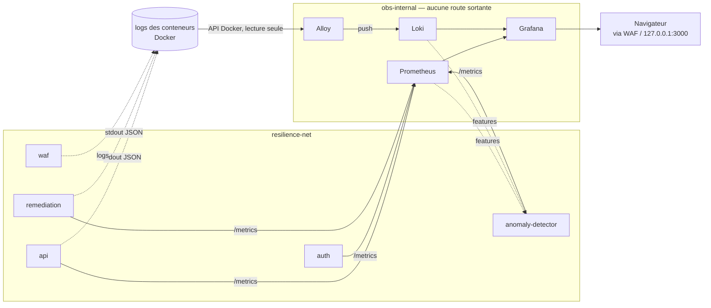

# Observabilité — Prometheus, Loki, Alloy, Grafana

> Source de vérité des règles du projet : [`CLAUDE.md`](../../CLAUDE.md). Vue d'ensemble : [`architecture.md`](architecture.md).

## 1. Rôle

La pile d'observabilité doit rendre l'incident **visible avant, pendant et après**, et montrer le pipeline de remédiation (`détection → décision → action → vérification`). Elle sert trois consommateurs :

1. le **jury**, via un dashboard Grafana unique qui raconte l'incident sans manipulation ;
2. le **détecteur ML**, qui lit les métriques Prometheus et les logs Loki pour construire ses features ;
3. la **fonction SOC**, qui exploite les logs JSON structurés corrélés par `trace_id`.

Un conteneur qui redémarre ne prouve rien : le dashboard affiche donc aussi le résultat de la **transaction de vérification**, qui est la seule preuve de reprise.

## 2. Composants

| Composant | Image épinglée | `mem_limit` | Port interne | Publié ? |
|---|---|---|---|---|
| Prometheus | `prom/prometheus:v3.1.0` | 512 Mo | 9090 | non |
| Loki | `grafana/loki:3.4.2` | 384 Mo | 3100 | non |
| Grafana Alloy | `grafana/alloy:v1.7.1` | 128 Mo | 12345 | non |
| Grafana | `grafana/grafana:11.5.2` | 256 Mo | 3000 | oui, sur `127.0.0.1` uniquement |

Total : **1 280 Mo (1,25 Go)** sur les 16 Go du PC Hôte. Aucune image en `latest` : une démonstration rejouée cinq fois doit tourner sur les mêmes binaires que la veille.

Chaque service a un `healthcheck`, un `restart: unless-stopped`, `cap_drop: ALL`, `no-new-privileges` et une rotation de logs (`max-size: 10m`, `max-file: 3`) pour ne pas remplir le disque pendant un flood.

Fichiers :

```
infra/observability/
  prometheus/prometheus.yml
  loki/loki-config.yml
  alloy/config.alloy
  grafana/provisioning/datasources/datasources.yml
  grafana/provisioning/dashboards/dashboards.yml
  grafana/dashboards/resilience-alpha.json
infra/compose/docker-compose.observability.yml
```

## 3. Flux de données



## 4. Exposition réseau

La règle non négociable du projet est respectée : **seul le point d'entrée est publié**.

- `obs-internal` (nom Docker : `resilience-obs-internal`) est déclaré `internal: true` : les conteneurs qui y sont attachés n'ont aucune route vers l'extérieur du PC Hôte.
- **Prometheus, Loki et Alloy ne publient aucun port.** Prometheus est en plus attaché à `resilience-net` parce qu'il doit joindre `api`, `auth`, `remediation` et `anomaly-detector` par leur nom DNS Docker.
- **Grafana** est la seule interface consultable. Elle est publiée sur `127.0.0.1:3000` (jamais `0.0.0.0`), donc injoignable depuis le PC Attaquant ; elle est atteinte depuis le réseau via le WAF, qui la joint par `resilience-net`.
- Le réseau `resilience-net` appartient à `infra/compose/docker-compose.yml` et est déclaré ici en `external: true`. La pile principale doit donc être démarrée d'abord. Si la pile principale préfixe le nom du réseau par son nom de projet, la variable `RESILIENCE_NET_NAME` permet de pointer le nom réel sans modifier le fichier.

## 5. Métriques

### Contrat d'instrumentation

Prometheus scrape le port **8000**, chemin **`/metrics`**, sur `api`, `auth`, `remediation` et `anomaly-detector`. Le dashboard attend les séries suivantes, qui correspondent aux conventions usuelles d'un instrumentateur FastAPI :

| Série | Type | Labels utilisés |
|---|---|---|
| `http_requests_total` | compteur | `status` (et `method`, `handler`) |
| `http_request_duration_seconds_bucket` | histogramme | `le` (et `method`, `handler`) |

Le label `service` n'est **pas** attendu des applications : il est ajouté par Prometheus cible par cible (`service: api`, `service: auth`, …). Le dashboard fonctionne donc même si une équipe nomme ses métriques autrement — il suffit d'ajuster les requêtes, pas la topologie.

### Cibles absentes

Tous les services sont configurés, y compris ceux qui ne répondent pas encore. C'est volontaire : une cible injoignable n'est pas une erreur de configuration, Prometheus l'expose avec `up == 0`. C'est exactement le signal « service tombé » dont le dashboard et le détecteur ML ont besoin. Aucune cible n'est commentée, et la pile démarre normalement même si aucun microservice n'existe.

### Pas de règles d'alerte

Ni Alertmanager ni fichier de règles : les seuils codés en dur sont explicitement exclus par le sujet. La détection appartient au modèle ML, la décision au moteur de remédiation. Cela économise aussi de la RAM.

## 6. Logs

### Convention du projet

Chaque service écrit sur `stdout` une ligne JSON par événement, avec au minimum `service`, `trace_id` et `event`. Le moteur de remédiation (`JsonStdoutPublisher`) ajoute `incident_id`, `at` et un objet `data` :

```json
{"service":"remediation","trace_id":"ab12…","event":"verification.completed","incident_id":"cd34…","at":"2026-10-21T14:03:11.512+00:00","data":{"attempt":1,"api_healthy":true,"probe_transaction_ok":true,"detail":"reprise prouvée"}}
```

Événements émis par le pipeline : `incident.detected`, `decision.made`, `action.executed`, `verification.completed`, `incident.resolved`, `incident.failed`.

### Traitement par Alloy

`loki.process` applique, à toutes les lignes :

- extraction JSON (`stage.json`) des champs `service`, `trace_id`, `event`, `incident_id`, `at`, `level`, puis de `data.action`, `data.probe_transaction_ok`, `data.api_healthy` ;
- **labels indexés** (`stage.labels`) : `service`, `trace_id`, `event` — les trois clés exigées par les conventions du projet, celles qui rendent les logs exploitables en SIEM ;
- **métadonnées structurées** (`stage.structured_metadata`) : `incident_id`, `level`, `action`, `probe_ok`, `api_healthy` — requêtables mais non indexées, pour ne pas multiplier les séries ;
- **horodatage applicatif** (`stage.timestamp` sur `at`) : l'ordre détection → décision → action → vérification reste exact dans Grafana, même si la collecte prend du retard pendant le flood.

Labels d'infrastructure ajoutés par la découverte Docker : `container`, `compose_service`, `compose_project`, `stream`, plus `job="docker"`, `env="lab"`, `site="pc-hote"`.

Une ligne **non JSON** (Prometheus, Grafana, Nginx…) traverse le pipeline sans être modifiée : les étapes d'extraction échouent silencieusement et la ligne est indexée avec ses seuls labels d'infrastructure. Aucun log n'est perdu.

### Cardinalité de `trace_id`

`trace_id` est un label indexé parce que les conventions du projet l'exigent et parce que c'est la clé de corrélation d'un incident. Sa cardinalité reste faible ici : un `trace_id` par incident, donc une poignée par passage de démonstration. Dans un contexte industriel, avec des milliers d'incidents par jour, il faudrait le déplacer en métadonnée structurée — c'est un réglage à changer dans `stage.labels`, pas une refonte.

### Rétention

Loki tourne en mode `single-binary` (`-target=all`), stockage `filesystem`, **rétention 24 h**. Pas de S3, pas d'anneau externe (`kvstore: inmemory`), pas de conteneur compactor séparé : le compactor tourne dans le même processus, car c'est lui qui applique réellement la rétention (`compactor.retention_enabled: true`). Prometheus garde également 24 h, plafonné à 512 Mo de TSDB.

## 7. Accès Docker d'Alloy

**Choix retenu : API Docker via le socket, monté en lecture seule**, avec l'endpoint piloté par la variable `ALLOY_DOCKER_HOST`.

### Pourquoi pas `/var/lib/docker/containers`

Lire directement les fichiers `*-json.log` évite le socket, mais :

- l'arborescence n'expose que des **identifiants de conteneurs**, pas les noms de services ; les logs arriveraient dans Loki sans label `container` ni `compose_service`, donc inexploitables en SIEM et inutilisables par le dashboard ;
- elle impose de monter **tout l'arbre des logs du démon Docker**, y compris ceux de conteneurs hors projet, ce qui est un périmètre de lecture *plus large*, pas plus étroit ;
- les fichiers sont lisibles par `root` seulement : il faudrait quand même un conteneur privilégié, pour un résultat moins bon.

### Risque assumé

Le socket Docker est une interface d'administration complète. **Le montage en lecture seule protège le nœud d'inode, pas le protocole** : un processus qui peut écrire sur le socket peut créer un conteneur privilégié, donc prendre le contrôle du PC Hôte. Alloy tourne par ailleurs en `root` dans son conteneur, parce que le socket n'est pas lisible autrement.

Atténuations en place :

- Alloy est attaché au **seul réseau `obs-internal`**, sans route sortante et sans port publié : il n'est joignable par aucun composant exposé ;
- `cap_drop: ALL` et `no-new-privileges:true` ;
- sa configuration est montée en lecture seule et versionnée ; il ne reçoit aucune entrée venant du réseau exposé.

### Durcissement prévu

La cible est de faire passer Alloy par le **docker-socket-proxy** déjà présent dans l'architecture (propriété de Hugo), configuré en `CONTAINERS=1` et en lecture seule (méthodes `GET` uniquement). Alloy n'a besoin que de `GET /containers/json` et `GET /containers/<id>/logs`.

La bascule ne demande **aucune modification de fichier** : il suffit de renseigner

```
ALLOY_DOCKER_HOST=tcp://docker-proxy:2375
```

et d'attacher Alloy au réseau du proxy, puis de retirer le montage du socket. C'est l'alignement complet avec la règle du projet « aucun composant non privilégié ne touche le `docker.sock` ».

> Rappel : le moteur de remédiation, lui, passe **déjà** par le docker-socket-proxy (`DockerProxyClient`). Alloy est la seule exception temporaire, et elle est en lecture seule.

## 8. Grafana

### Provisionnement automatique

Rien ne se configure à la main, condition pour rejouer la démonstration au moins cinq fois sans intervention :

- `provisioning/datasources/datasources.yml` crée **Prometheus** (UID `prometheus`, source par défaut) et **Loki** (UID `loki`). Les UID sont figés car le dashboard les référence. `deleteDatasources` rend le provisionnement idempotent même si une source a été créée à la main.
- `provisioning/dashboards/dashboards.yml` charge tous les JSON de `/var/lib/grafana/dashboards` dans le dossier `Resilience-Alpha`, avec `allowUiUpdates: false` : le dashboard est du code versionné, une modification faite à la main pendant la démonstration est écrasée au prochain démarrage.
- `GF_DASHBOARDS_DEFAULT_HOME_DASHBOARD_PATH` fait de `resilience-alpha.json` la page d'accueil : **zéro clic** pour arriver sur la vue de l'incident.

### Secrets

Le mot de passe admin vient de `GRAFANA_ADMIN_PASSWORD`, jamais du compose ni du provisionnement. La variable est déclarée **obligatoire** (`${GRAFANA_ADMIN_PASSWORD:?…}`) : sans elle, la pile refuse de démarrer au lieu de retomber sur un `admin/admin` silencieux. Aucun mot de passe n'apparaît dans un fichier versionné, ni dans les logs.

### Accès anonyme — réglage de laboratoire

`GF_AUTH_ANONYMOUS_ENABLED=true` avec le rôle `Viewer` : le clip de 60 secondes doit se dérouler sans coupe, et saisir un identifiant à l'écran coûterait plusieurs secondes et afficherait un secret.

> **Ce réglage n'est pas un réglage de production.** Toute personne atteignant Grafana lit toutes les métriques et tous les logs sans authentification. Il est acceptable ici parce que Grafana n'écoute que sur `127.0.0.1`, que le rôle est en lecture seule et que toutes les données sont fictives. Hors démonstration, poser `GRAFANA_ANONYMOUS_ENABLED=false` suffit à le désactiver. C'est un écart conscient, à mentionner comme tel dans le volet gouvernance (NIS2 : contrôle d'accès).

### Dashboard `resilience-alpha`

Une seule vue, qui raconte l'incident de haut en bas :

| Panneau | Source | Ce qu'il prouve |
|---|---|---|
| Santé des services | Prometheus `up{service=~…}` | avant / pendant / après, en un coup d'œil |
| Transactions de vérification réussies / refusées | Loki `verification.completed` | **la preuve de reprise** |
| Incidents clos sans intervention / en échec | Loki `incident.resolved` / `incident.failed` | le Zero-Touch Recovery, chiffré |
| Débit de l'API | Prometheus `rate(http_requests_total)` | le pic du flood, le creux du redémarrage, le retour à la normale |
| Erreurs 5xx | Prometheus (part et débit) | la dégradation puis sa disparition |
| Latence p50 / p95 | Prometheus `histogram_quantile` | le signal précoce utilisé par le ML |
| Pipeline de remédiation | Loki, les six événements | détection → décision → action → vérification, en ordre chronologique |
| Preuve de reprise | Loki, `line_format` lisible | `api_healthy` **et** `transaction_ok` |

Deux annotations Loki tracent une ligne verticale sur tous les graphiques : **rouge** à `incident.detected`, **verte** à `incident.resolved`. L'écart entre les deux lignes est le temps de reprise automatique, lisible directement à l'écran.

Rafraîchissement 10 s, fenêtre par défaut 30 minutes.

## 9. Lancement

```bash
# 1. La pile principale d'abord : c'est elle qui crée le réseau resilience-net
docker compose -f infra/compose/docker-compose.yml up -d

# 2. La pile d'observabilité
docker compose -f infra/compose/docker-compose.observability.yml up -d
```

La pile d'observabilité porte son propre nom de projet (`resilience-alpha-obs`). Elle est donc **autonome** et survit aux redémarrages de conteneurs déclenchés par le moteur de remédiation — c'est indispensable pour montrer l'incident pendant qu'il a lieu. Corollaire : **ne pas la fusionner** avec la pile principale via plusieurs `-f`, son `name:` écraserait le nom de projet de l'autre.

Grafana est ensuite sur <http://127.0.0.1:3000/> et ouvre directement le dashboard.

### Rejouabilité

Les quatre volumes nommés (`resilience-prometheus-data`, `resilience-loki-data`, `resilience-alloy-data`, `resilience-grafana-data`) persistent d'un passage à l'autre : l'historique des cinq démonstrations reste consultable, ce qui est un atout devant le jury. Pour repartir d'une ardoise vierge, le script de reset doit faire `docker compose -f infra/compose/docker-compose.observability.yml down -v`.

## 10. Variables d'environnement

À ajouter à `.env.example` (aucune ne contient de secret réel).

| Variable | Rôle | Défaut |
|---|---|---|
| `GRAFANA_ADMIN_PASSWORD` | mot de passe admin Grafana — **obligatoire**, la pile refuse de démarrer sans | aucun |
| `GRAFANA_ADMIN_USER` | identifiant admin Grafana | `admin` |
| `GRAFANA_HTTP_PORT` | port publié sur `127.0.0.1` | `3000` |
| `GRAFANA_ROOT_URL` | URL publique vue par les navigateurs, derrière le WAF | `http://127.0.0.1:3000/` |
| `GRAFANA_SERVE_FROM_SUB_PATH` | à passer à `true` si le WAF expose Grafana sous un sous-chemin | `false` |
| `GRAFANA_ANONYMOUS_ENABLED` | accès anonyme en lecture ; `true` pour la démonstration, `false` sinon | `true` |
| `ALLOY_DOCKER_HOST` | endpoint Docker d'Alloy ; à pointer vers le docker-socket-proxy pour durcir | `unix:///var/run/docker.sock` |
| `LOKI_PUSH_URL` | URL de push Loki utilisée par Alloy | `http://loki:3100/loki/api/v1/push` |
| `RESILIENCE_NET_NAME` | nom Docker réel du réseau externe créé par la pile principale | `resilience-net` |

## 11. Limites connues

- **Métriques applicatives absentes** tant que `api`, `auth`, `remediation` et `anomaly-detector` n'exposent pas `/metrics`. Les panneaux de débit, d'erreurs et de latence resteront vides ; les panneaux de santé et les panneaux Loki, eux, fonctionnent immédiatement.
- **Noms de séries à confirmer** avec les propriétaires des services (`http_requests_total`, `http_request_duration_seconds`). Si l'instrumentation choisie diffère, seules les requêtes du dashboard changent.
- **Alloy accède au socket Docker** (lecture seule) ; le durcissement via docker-socket-proxy reste à faire avec Hugo, cf. section 7.
- **Accès anonyme à Grafana** activé pour la démonstration, cf. section 8.
- **Pas d'Alertmanager, pas de Wazuh** : la fonction SOC repose sur Loki + Grafana, choix assumé pour tenir le budget RAM de 16 Go.
- Les configurations n'ont **pas** été validées à l'exécution (`promtool check config`, `loki -verify-config`, `alloy fmt`) : le démon Docker n'était pas accessible depuis l'environnement de développement utilisé. Seules la syntaxe YAML/JSON et `docker compose config` ont été vérifiées. À rejouer au premier `up` réel.
