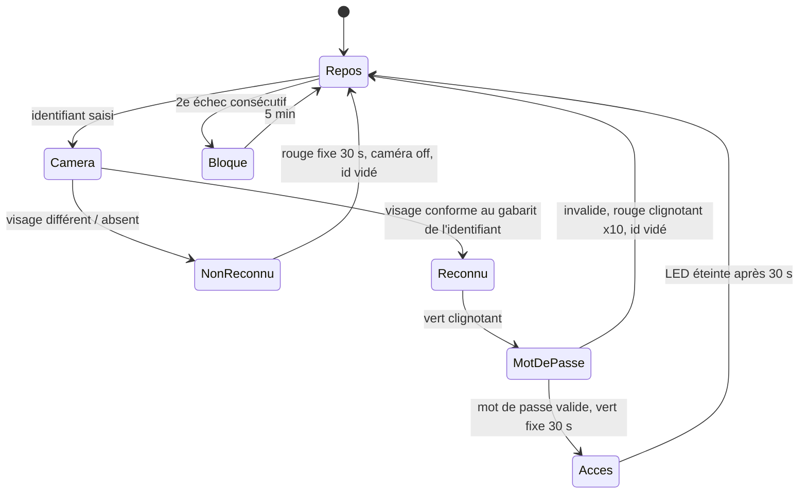
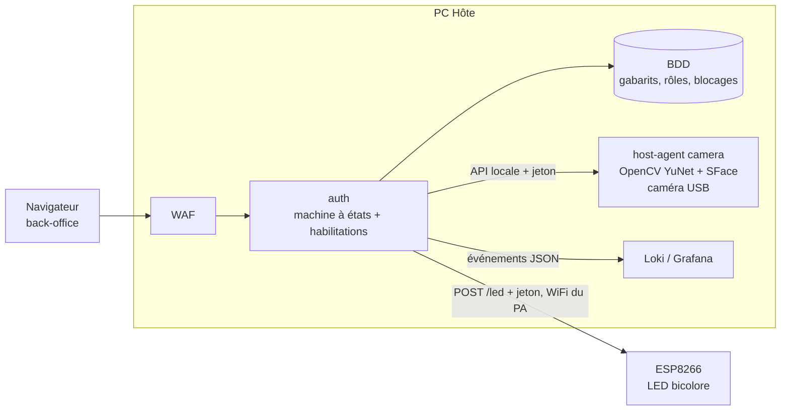

# Consigne additionnelle 1 — authentification renforcée du back-office

Source : `docs/WorkShop 2026-27 M2 - Consigne Additionnelle 1.pdf` (reçue le 22/10). Le sujet précise : « soyez à l'écoute de toutes nouvelles consignes ».
Statut : **analyse et conception, aucune ligne de code écrite.** Les choix marqués *(proposition)* sont à valider par l'équipe ; les points marqués **[à trancher]** bloquent le développement.

## 1. Ce que demande la consigne

1. Après la saisie de l'identifiant, **activer une caméra USB** pour confirmer que la personne est bien le titulaire de l'identifiant. Si oui, la saisie du mot de passe est permise ; sinon l'identifiant est vidé et la caméra s'éteint.
2. L'utilisateur peut **recommencer 1 fois**, puis est **bloqué 5 minutes**, « etc. ».
3. La caméra est **obligatoirement branchée sur le PC Hôte** (celui qui délivre le point d'accès `RESILIENCE-G<n>` et héberge Docker).
4. Le PC Hôte intègre une **IA légère de reconnaissance de visage**, gérée dans le back-office, avec **gestion complète des habilitations**.
5. Un **ESP8266** (IDE obligatoire : JetBrains CLion + PlatformIO) équipé d'une **LED bicolore rouge/vert**, connecté en WiFi au point d'accès du groupe.

### Comportement de la LED (machine à états)

| Étape | Condition | LED | Suite |
|---|---|---|---|
| Repos | — | **éteinte** | attente d'un identifiant |
| Identifiant saisi | caméra activée, visage comparé | éteinte | reconnu ou non |
| Visage **non reconnu** | — | **rouge fixe 30 s** | caméra éteinte, identifiant vidé, ressaisie possible après les 30 s |
| Visage **reconnu** | — | **vert clignotant** | jusqu'à la saisie du mot de passe |
| Mot de passe **valide** | — | **vert fixe 30 s**, puis éteinte | page du back-office disponible |
| Mot de passe **invalide** | — | **rouge clignotant × 10**, puis éteinte | identifiant vidé, caméra éteinte, on reprend toute l'identification |

## 2. Interprétations à confirmer **[à trancher]**

| # | Ambiguïté du texte | Lecture retenue (proposition) | Qui tranche |
|---|---|---|---|
| 1 | « Recommencer 1 fois puis bloqué 5 minutes, etc. » | 2 échecs consécutifs (1 essai + 1 reprise) → blocage 5 min ; à la sortie du blocage, le compteur repart à 0 et le même schéma se répète. Variante possible : durée qui double (5, 10, 20 min) | Équipe, puis demander à l'enseignant |
| 2 | Un mot de passe invalide compte-t-il comme échec ? | Oui : tout échec (visage **ou** mot de passe) incrémente le compteur, sinon on contourne le blocage par le mot de passe | Équipe |
| 3 | Le blocage porte sur quoi ? | L'**identifiant** (et non l'IP, indistincte sous Docker Desktop : voir arbitrage du 20/10), conservé en base, donc survit à un redémarrage | Kevin |
| 4 | « Confirmer l'identificateur » | Vérification **1:1** : le visage est comparé au gabarit enregistré **pour l'identifiant saisi**, pas une recherche 1:N dans toute la base | Kevin |
| 5 | « Back-office » | Il n'existe pas encore : l'existant est le front Pay-Now (inscription, connexion, virements). Il faut créer une page `/admin` (habilitations, enrôlement), sans toucher au parcours client | Antoine / Gabriel |
| 6 | Reconnaissance « sur le PC Hôte » | Capture **et** inférence sur le PC Hôte ; les gabarits ne quittent jamais ce PC | Kevin |

## 3. Architecture proposée

Contrainte technique majeure : **Docker Desktop (WSL2) ne voit pas une caméra USB**. Deux voies :

| Option | Principe | Avantages | Inconvénients |
|---|---|---|---|
| **A. Agent hôte natif (recommandée)** | Petit service Python Windows (`host-agent/camera`), hors Docker, qui ouvre la caméra (OpenCV) et expose une API locale restreinte à l'API d'auth | Aucun passthrough USB à fiabiliser ; démarrage/arrêt de la caméra précis (exigence « la caméra s'éteint ») | Hors Compose : « une seule commande » à étendre (`Deploy.ps1` le lance) |
| B. `usbipd-win` + conteneur | Attacher la caméra à WSL2 puis au conteneur | Tout reste dans Docker | Fragile sous Windows 11 Home/WSL2, noyau WSL à recompiler pour les pilotes UVC, risque élevé à 1 jour du gel |

**Reconnaissance** *(proposition)* : OpenCV `FaceDetectorYN` (YuNet) + `FaceRecognizerSF` (SFace), modèles ONNX d'environ 40 Mo au total, CPU seul, aucune compilation dlib (écarte `face_recognition`, lourd à installer sur Windows). Seuil de similarité cosinus fixé sur les données de l'équipe, mesuré (taux de faux rejet / fausse acceptation) et consigné, comme pour le ML d'anomalies : pas de seuil « au hasard ».

**ESP8266** *(proposition)* : firmware PlatformIO dans `firmware/esp8266-led/` (ouvrable dans CLion), deux GPIO pour la LED bicolore (résistances série), client WiFi du point d'accès. L'ESP8266 expose `POST /led` (`{"mode":"off|green_blink|green_solid|red_blink|red_solid"}`, jeton partagé) ; les durées (30 s, 10 clignotements) sont gérées **dans le firmware** pour que la LED reste cohérente si le réseau coupe. Pas de broker MQTT : un service de plus coûterait de la RAM pour rien.

Hexagonal (comme le reste) : ports `FaceVerifier`, `CameraControl`, `StatusLed`, `LockoutStore` dans le domaine ; adaptateurs `OpenCvFaceVerifier`, `HostCameraClient`, `HttpStatusLed`, `PostgresLockoutStore` ; fakes pour les tests. Logique d'authentification dans `application/`, pas dans les routes.

## 4. Habilitations (back-office)

- Rôles minimaux *(proposition)* : `admin` (gère comptes, rôles, enrôlements), `operator` (consulte le tableau de supervision), `customer` (parcours Pay-Now, **hors** authentification faciale : la consigne vise le back-office).
- Fonctions : créer/désactiver un compte, attribuer/retirer un rôle, **enrôler / révoquer un visage**, débloquer un identifiant, consulter le journal d'accès.
- Un `admin` ne peut ni s'auto-retirer le dernier rôle admin ni enrôler un visage sans reconnaissance préalable d'un autre admin (amorçage : compte `admin` créé par le seed).
- Tout changement d'habilitation émet un événement `auth.role.changed` (Loki).

## 5. Sécurité, conformité et données

| Sujet | Position |
|---|---|
| Donnée biométrique | Donnée sensible (RGPD art. 9). Règle du dépôt « 100 % fictif » : **seuls les membres de l'équipe, volontaires et informés par écrit, sont enrôlés**, aucune autre personne, aucun visage envoyé à une IA externe ou au RAG |
| Stockage | Uniquement le **gabarit** (vecteur de 128 valeurs), jamais l'image ; chiffré au repos, clé gérée par SOPS (même chaîne que les secrets) ; aucun gabarit dans Git, les images, les logs ni le `-Code.zip` |
| Caméra | Active uniquement entre la saisie de l'identifiant et la décision ; aucune image conservée, aucun flux enregistré |
| Usurpation (photo, écran) | **Non couvert** sans détection de vivacité ; à assumer dans « Limites connues », à ne pas promettre au jury |
| Échec fermé | Caméra, agent ou ESP8266 indisponible → pas d'accès au back-office (jamais de repli sur le mot de passe seul) ; LED non joignable : l'accès n'en dépend pas, mais l'événement est journalisé |
| Exposition | L'agent hôte n'écoute que sur l'IP locale joignable par `auth`, jeton requis ; l'ESP8266 n'accepte que l'IP du PC Hôte ; ni l'un ni l'autre n'est publié par le WAF |
| Périmètre offensif | Inchangé : attaques uniquement depuis le PC Attaquant. Le déni de service sur l'ESP8266 ou la caméra est à traiter comme scénario du chaos |

## 6. Lien avec les 5 piliers

| Pilier | Impact |
|---|---|
| Dev | Page `/admin`, API d'habilitations, agent caméra, firmware ESP8266 |
| Infra | Déploiement de l'agent hôte par `Deploy.ps1`, WiFi de l'ESP8266 sur le point d'accès, `mem_limit` inchangé (l'agent est hors Docker : mesurer sa RAM) |
| IA/Data | Deuxième modèle ML, de reconnaissance cette fois : seuil et taux d'erreur mesurés |
| Cyber | Nouveaux risques ER7/ER8, nouveau vecteur physique, blocage par identifiant |
| Gouvernance | EBIOS (SS6, SO3), AMDEC, matrice, NIS2/DORA (authentification forte), PCA : mode dégradé si la caméra tombe |

## 7. Découpage proposé

| Lot | Contenu | Porteur proposé | Dépend de |
|---|---|---|---|
| L1 | Machine à états d'authentification (Kevin), tables et verrouillage en base (Hugo), ports | Kevin + Hugo | décisions §2 |
| L2 | Agent hôte caméra + reconnaissance, mesure des seuils | Kevin | caméra sur le PC Hôte |
| L3 | Firmware ESP8266 (CLion + PlatformIO) + test sur banc ; WiFi et pare-feu | Antoine (firmware), Hugo (réseau) | matériel + WiFi du PA |
| L4 | Page `/admin`, habilitations, enrôlement | Gabriel | L1 |
| L5 | Scénarios d'attaque physique/IT (usurpation, force brute, DoS ESP), chaos | François | L1 à L3 |
| L6 | EBIOS, AMDEC, matrice, PCA (Hugo) ; NIS2/DORA, dossier (Gabriel) | Hugo + Gabriel | tout |

Tâches détaillées, livrables et échéances par personne : [`repartition-reelle.md`](repartition-reelle.md) §7.

## 8. Risque de calendrier

Nous sommes jeudi 22/10 ; le **gel du code est à 17 h** et le vendredi est réservé au jury (« on ne code plus »). Cette consigne ajoute du matériel (caméra, ESP8266), une page et un modèle : **elle ne tient pas dans le temps restant sans arbitrage**.

Options à décider **[à trancher, Kevin avec l'équipe, et à confirmer auprès de l'enseignant]** :

1. Demander si le gel et la remise sont décalés pour cette consigne (à vérifier : le sujet dit « soyez à l'écoute »).
2. Si non : livrer une **tranche minimale démontrable** (identifiant → caméra → reconnu/non reconnu → LED → mot de passe → blocage) et consigner tout le reste en limites assumées.
3. Ne **rien dégrader** du fil rouge existant : développement sur branche, merge seulement si les tests `pytest` et `scripts/demo_loop.py --runs 5` restent verts.
