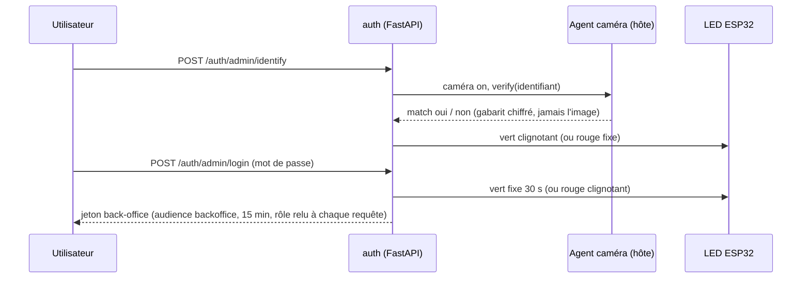
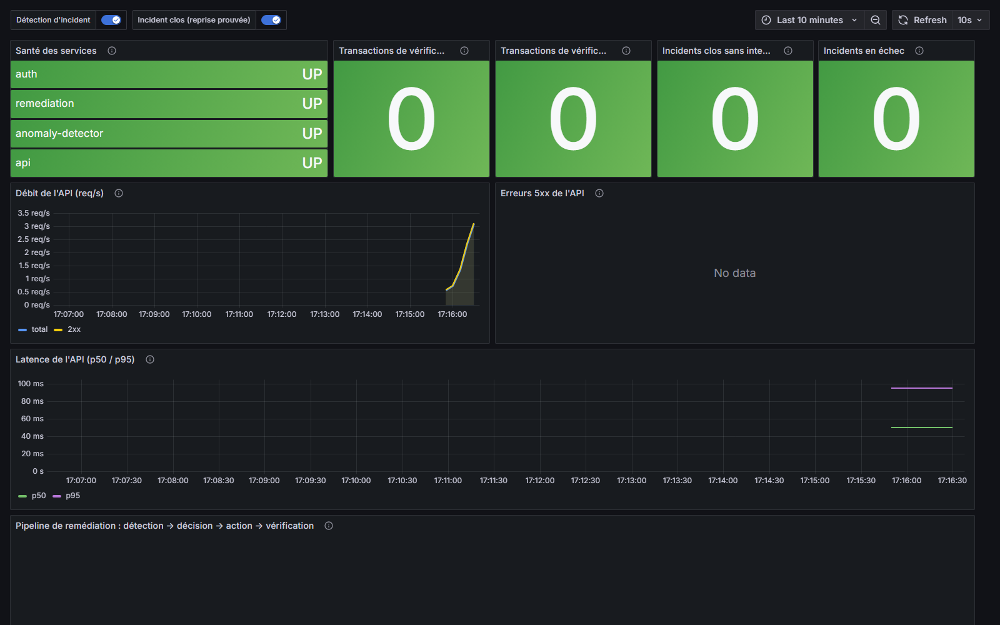
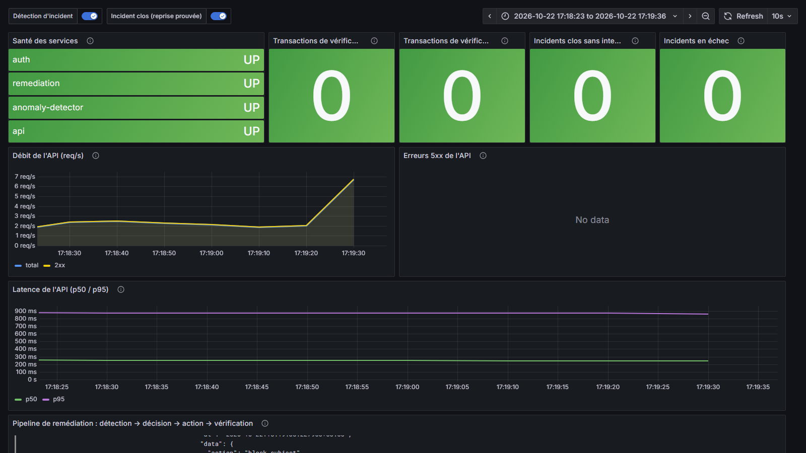
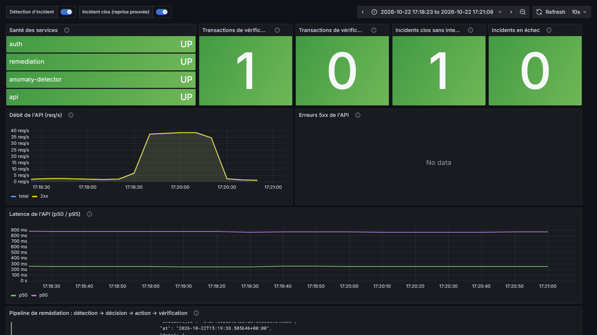
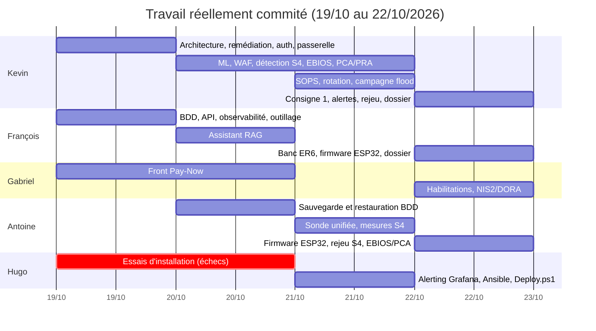

# PROJECT RESILIENCE-ALPHA : Dossier technique

**Workshop Bac+5 M2, Groupe 2**
Plateforme de paiement fictive conteneurisée, auto-réparante (Zero-Touch Recovery).

> Source de ce document : dépôt `Resilience-Alpha`. Les chiffres proviennent d'essais réels
> consignés dans [`gouvernance/02-pca-pra.md`](gouvernance/02-pca-pra.md) §7 et
> [`repartition-reelle.md`](repartition-reelle.md). Règles du projet : [`CLAUDE.md`](../CLAUDE.md).
> Document source (Markdown) ; export PDF pour la remise `Workshop2026-M2-G2-Dossier.pdf`.

---

## 1. Résumé exécutif

Resilience-Alpha est une plateforme de paiement **fictive**, entièrement conteneurisée, qui
subit une attaque lancée depuis un second poste (PC Attaquant), la **détecte par apprentissage
automatique**, se **répare sans intervention humaine**, et **prouve la reprise par une nouvelle
transaction de test réussie**. Le service est observable **avant, pendant et après** l'incident
dans un tableau de bord Grafana.

Principe directeur : *un conteneur qui redémarre ne prouve rien*. Un incident n'est déclaré clos
que lorsque l'API répond **et** qu'une transaction de sonde passe.

Résultat mesuré (chaos du 22/10 à 10:35, `demo_loop.py --runs 5` lancé depuis le PC Hôte vers le
WAF, 5 passages consécutifs sans intervention) : **5/5 reprises automatiques**, RTO moyen 32 s
(max 35 s), transaction de test réussie à chaque passage. Un flood isolé lancé depuis le PC
Attaquant a aussi été repris automatiquement le même jour (voir §6). Rejeu du soir, après la dernière
correction (reset puis 5 passages, flood depuis le PC Hôte) : 5/5, RTO moyen 31 s (max 34 s).

---

## 2. Mission et fil rouge

| Temps | Ce que montre la démonstration |
|---|---|
| Avant | Service sain, trafic de fond légitime, transactions qui passent |
| Pendant | Attaque réelle depuis le PC Attaquant à travers le WAF ; détection ML ; décision ; action |
| Après | Reprise automatique, vérifiée par une transaction de sonde ; état observable dans Grafana |

La démonstration est **rejouable en boucle** (≥ 5 passages) grâce à un script de remise à l'état
initial (`scripts/reset_demo.sh`) et au pilote `scripts/demo_loop.py`.

Configuration de la démonstration (vendredi) : réseau privé du binôme, **hotspot Windows,
PC Hôte en `192.168.137.1`**, seul le WAF publié (`192.168.137.1:8080`). Ollama hébergé sur un
PC Linux dédié (`192.168.137.157:11434`). Jamais le réseau du campus, un autre groupe ni Internet.

---

## 3. Architecture

### 3.1 Vue d'ensemble

Le PC Hôte héberge toute la plateforme en Docker Compose, répartie sur des réseaux cloisonnés ;
seul le WAF publie un port. Le PC Attaquant n'atteint la plateforme que par le WAF. Détail et
schéma : [`architecture/architecture.md`](architecture/architecture.md).

- **Réseau public** : WAF (ModSecurity + OWASP CRS) → passerelle Caddy (front React servi en
  statique, routage `/auth/*`, `/me/*`, `/grafana`).
- **Réseau app (interne)** : API métier, auth, PostgreSQL, `db-recovery`.
- **Réseau obs (interne)** : Prometheus, Loki + Alloy, Grafana.
- **Réseau control (interne)** : détecteur ML, moteur de remédiation, `docker-proxy-ctl`, secrets
  SOPS (fichiers chiffrés montés).
- **Réseau rag (isolé)** : assistant RAG, seul membre ; aucun chemin vers l'API, la base, le
  moteur ni Docker.

Schéma (source : [`architecture/architecture.md`](architecture/architecture.md) §1) :

*Figure 1, Réseaux cloisonnés ; seul le WAF est publié. Les flèches pleines sont des flux
applicatifs, les pointillées des flux d'observation.*

### 3.2 Principes SOLID (architecture hexagonale)

Chaque service Python suit une architecture en couches `domain` / `application` / `adapters` /
`api` ; les dépendances pointent vers le domaine. Le moteur de remédiation en est l'exemple le
plus net : détection, décision, action et vérification sont des composants séparés (S), un
nouveau type d'attaque ou d'action s'ajoute par une classe enregistrée dans un registre sans
modifier l'existant (O), toute implémentation d'un port est interchangeable avec un *fake* en
test (L), les ports sont petits et ciblés, `ContainerRestarter`, `IpBlocker`, `HealthChecker`,
`TransactionProbe`… (I), et les adaptateurs concrets (Docker, HTTP, SOPS) sont injectés dans le
composition root (D).

---

## 4. Les cinq piliers

### 4.1 Dev

| Composant | Technologie et choix | Détail vérifiable |
|---|---|---|
| API métier | FastAPI, SQLAlchemy 2 asynchrone (asyncpg), Alembic ; image `python:3.12-slim`, utilisateur non-root, `mem_limit` 256 Mo | Virements en **grand livre à double entrée**, montants en centimes entiers (aucun `float`), idempotence par clé unique ; `GET /health` fait un vrai `SELECT 1` |
| Base de données | PostgreSQL 16, réseau interne `db-internal` | Contraintes portées par la base (solde ≥ 0, montant > 0, comptes distincts) ; rôles `app_rw` (ni `DELETE` ni DDL, écritures comptables non modifiables) et `app_ro` (RAG) |
| Authentification | FastAPI, JWT HS256, hachage argon2 | Parcours client (`/auth/register`, `/auth/login`) et parcours back-office renforcé (§4.6) |
| Sauvegarde / restauration | Service `db-recovery` : `pg_dump` toutes les 300 s, 12 archives gardées, `pg_restore` en une transaction | Archives `0600`, écriture atomique, restauration bornée par `before=<date>` |
| Front de paiement | **Pay-Now** : React + TypeScript + Tailwind + Vite | Construit dans l'image `gateway`, servi en statique par Caddy derrière le WAF ; aucun script tiers ni CDN ; session en `sessionStorage` |
| Moteur de remédiation | Pipeline `Detector → DecisionPolicy → RemediationAction[] → RecoveryVerifier` (§5) | Accès Docker uniquement via `docker-socket-proxy` |
| Supervision | **Grafana** provisionné (`infra/observability/grafana/dashboards/resilience-alpha.json`), alimenté par Prometheus et Loki | Décision du 20/10 : pas de dashboard React |

### 4.2 Infra

- Orchestration **Docker Compose** en **deux projets autonomes** : `resilience-alpha` (socle) et
  `resilience-alpha-obs` (observabilité). Ils ne sont volontairement pas fusionnés : la pile
  d'observabilité survit aux redémarrages déclenchés par le moteur de remédiation, ce qui permet de
  montrer l'incident *pendant* qu'il a lieu.
- **Déploiement en une commande** : `infra/ansible/Deploy.ps1` (Windows + Docker Desktop) enchaîne
  contrôle du `.env`, modèle ML s'il est absent, socle, observabilité, vérification Ansible puis
  **transaction de test réelle**. Option `-RenderEnv` pour produire le `.env` depuis SOPS sur un
  clone neuf, `-CheckOnly` pour valider sans déployer.
- Observabilité **Prometheus + Grafana + Loki**, ingestion par **Alloy** (pas Promtail ni Elastic).
  Images épinglées :

| Service | Image | RAM |
|---|---|---|
| Prometheus | `prom/prometheus:v3.1.0` | 512 Mo |
| Loki | `grafana/loki:3.4.2` (rétention 24 h) | 384 Mo |
| Alloy | `grafana/alloy:v1.7.1` | 128 Mo |
| Grafana | `grafana/grafana:11.5.2`, seule interface consultable, sous `/grafana` derrière le WAF | 256 Mo |
| docker-proxy | `ghcr.io/tecnativa/docker-socket-proxy:v0.5.0`, lecture seule (`CONTAINERS=1`, `NETWORKS=1`) | 32 Mo |

- Pas d'Alertmanager, de node-exporter ni de cAdvisor : l'alerting intégré de Grafana ne sert qu'à la
  visibilité SOC, la détection appartient au ML.
- **Contrainte RAM** (PC Hôte 16 Go) : `mem_limit` sur les 18 services des deux fichiers Compose.
  Mesures : pile de base **885 Mo au repos, pic 990 Mo sous flood** ; pile d'observabilité
  **1 312 Mo** (somme des limites) ; Ollama déporté sur un 3e PC (`192.168.137.157`).
- **Exposition réseau** : seul le WAF publie un port (`${WAF_BIND_HOST:-127.0.0.1}:8080`) ; le port 3000
  de Grafana n'est plus publié.

### 4.3 IA / Data

- **Détection d'anomalies par ML** : `IsolationForest` (scikit-learn) sur 4 mesures Prometheus
  (débit de requêtes, part de 5xx, latence p95, `up`), échantillonnées toutes les 5 s. Pas de règles
  codées en dur : le seuil est **appris** à l'entraînement (plus mauvais score du trafic normal, moins
  une marge), avec confirmation sur 3 jugements consécutifs et un silence de refroidissement. Le jeu
  d'entraînement fictif est versionné (`ml/data/normal.csv`), donc un clone neuf peut s'entraîner.
- **Surveillance d'intégrité de la base** (S4) : un second cas d'usage lit trois compteurs
  (`GET /integrity`, aucune donnée) et signale `database_corruption` quand un invariant du grand livre
  est violé (compteur qui baisse alors que les tables sont en ajout seul, écritures déséquilibrées).
- **Qualité mesurée** : 0 fausse alerte sur 120 puis 60 mesures normales inédites (21/10 puis 22/10),
  attaque détectée (alerte à la 5e mesure).
- **Assistant RAG** : Ollama + LangChain, modèle `llama3.1:8b` (≤ 8B paramètres), embeddings
  `nomic-embed-text`, 8 extraits par question, température 0, **sources citées**. Lecture seule sur la
  documentation indexée, **aucun outil, aucun accès privilégié**, réseau `resilience-rag` isolé, conteneur
  `read_only` et `cap_drop: ALL`, jeton obligatoire, texte des questions jamais journalisé. Réponse en
  7 à 16 s. Interrogé hors ligne via `docker compose exec`.

### 4.4 Cyber

- **Attaque réelle** depuis le PC Attaquant : `attack/flood_http.py` (déni de service applicatif)
  et `attack/sqli_injection.py` (injection SQL). Garde-fous `ALLOWED_HOSTS` : toute cible hors
  périmètre exige `--yes-i-know-the-target`, jamais utilisé en démonstration.
- **WAF** ModSecurity + OWASP CRS (niveau de paranoïa 1), seul point d'entrée.
- **SOC** : fonction SIEM assurée par Loki + Grafana (décision du 21/10 : pas de Wazuh). La règle
  d'alerte **« WAF - Détection SQLi »** (dossier `SOC`) est provisionnée par le code et passe en
  `Firing` dès que le WAF journalise une injection SQL.
- **Secrets** : SOPS + age (choix du 21/10), aucun secret en clair dans le dépôt, les images, les
  logs ni le zip ; `.env` ignoré, `.env.example` fourni ; rotation `SopsSecretRotator` essayée en
  réel.
- **Durcissement** : réseaux Docker internes, `docker-socket-proxy` à endpoints restreints
  (jamais `docker.sock` en direct), `cap_drop`, `no-new-privileges`, conteneurs en lecture seule.

### 4.5 Gouvernance

- **EBIOS Risk Manager** : ateliers 1 à 5 ([`gouvernance/01-ebios-rm.md`](gouvernance/01-ebios-rm.md)).
  Événements redoutés ER1 à ER8, scénarios stratégiques SS1 à SS6, scénarios opérationnels SO1
  (flood) et SO2 (SQLi) reliés aux scripts d'attaque réels `attack/flood_http.py` et
  `attack/sqli_injection.py` ; SO3 (force brute / photo sur le back-office) est décrit mais son
  script d'attaque reste à écrire. Traitement du risque avec risque résiduel (§7).
- **PCA / PRA** : [`gouvernance/02-pca-pra.md`](gouvernance/02-pca-pra.md), RTO/RPO cibles et
  mesurés, journal des essais.
- **NIS2 / DORA** : [`gouvernance/03-nis2-dora.md`](gouvernance/03-nis2-dora.md), exigences
  pertinentes reliées au démonstrateur et obligations non démontrables par un prototype de 4 jours.
- **AMDEC** et **matrice de traçabilité** : [`gouvernance/05-amdec.md`](gouvernance/05-amdec.md),
  [`gouvernance/04-matrice-tracabilite.md`](gouvernance/04-matrice-tracabilite.md).

### 4.6 Authentification renforcée du back-office (consigne additionnelle 1)

Parcours **identifiant → caméra USB → reconnaissance de visage 1:1 → mot de passe**, en échec fermé :
caméra ou agent en panne, pas d'accès. Docker Desktop ne voyant pas la caméra USB, la capture et
l'inférence tournent dans un **agent hôte natif** (`host-agent/camera`, hors Compose).

| Exigence de la consigne | Réalisation | État au 22/10 |
|---|---|---|
| Reconnaissance de visage 1:1, IA légère | OpenCV YuNet + SFace, seuil 0,363 ; ~198 Mo de RAM caméra allumée | Prouvé en réel via le WAF |
| Mesure du seuil | Membre enrôlé : similarité 0,752 à 0,806 (10 mesures) ; autre membre consentant : 0,023 à 0,094 (10 mesures) | Échantillon minimal (1 imposteur), pas un taux d'erreur |
| 1 reprise puis blocage 5 min | Blocage **par identifiant** (pas par IP), `423` avec `Retry-After: 300` | Prouvé, en mémoire (non persisté) |
| Habilitations | Rôles `admin` / `operator`, aucun accès sans rôle, console `/admin/console`, jeton distinct refusé par l'API métier | Livré, testé avec des doubles (63 tests `auth`) |
| LED bicolore d'état | Firmware ESP32-DevKitC (PlatformIO), `POST /led` signé HMAC-SHA256 avec compteur anti-rejeu, filtre sur l'IP du PC Hôte, durées dans le firmware | Flashé et essayé sur banc : 5 modes OK, signature invalide 401, rejeu 409, IP hors liste 403 |
| Confidentialité biométrique | Gabarit de 128 valeurs chiffré (Fernet), jamais d'image, jamais dans Git, zip ou logs ; membres consentants seulement ; identifiant journalisé sous forme d'empreinte | Consentement écrit non formalisé |

Matériel : la consigne prévoyait un ESP8266 ; la carte disponible est une ESP32-DevKitC. Le firmware est
adapté en conséquence (GPIO25 vert, GPIO26 rouge, résistances de 220 à 330 Ω). La signature passe par
des paramètres d'URL car le `WebServer` ESP32 ne restitue pas les en-têtes personnalisés (PR #103).

---

## 5. Le moteur de remédiation (cœur de la preuve)

`Detector (ML) → DecisionPolicy → RemediationAction[] → RecoveryVerifier`. Chaque étape émet un
événement JSON (`incident.detected`, `decision.made`, `action.executed`,
`verification.completed`, `incident.resolved`) consommé par Loki, donc par Grafana.

La décision distingue explicitement **restauration de disponibilité** et **correction de
compromission** :

| Type d'incident | Déclencheur | Actions |
|---|---|---|
| `AVAILABILITY` | flood HTTP | `BlockIpAction` → `BlockSubjectAction` → `RestartServiceAction` |
| `CRASH` | conteneur arrêté | `RestartServiceAction` |
| `DATABASE_CORRUPTION` | altération BDD | `RestoreDatabaseAction` → `RestartServiceAction` → vérification |
| `COMPROMISE` | SQLi / exfiltration | `RotateSecretAction` (JWT) → redémarrage `auth` puis `api` |

La clôture d'un incident exige toujours : **API saine ET transaction de sonde réussie**.

---

## 6. Essais réels et chiffres

Mesure du RTO (décision du 19/10) : du **début d'attaque** (journal horodaté du script) à
l'événement `incident.resolved` dans Loki. Exception : le chiffre de S1 depuis le PC Attaquant
(4,84 s) va de `incident.detected` à `incident.resolved` (remédiation seule, délai de détection
non isolé). Journal complet :
[`gouvernance/02-pca-pra.md`](gouvernance/02-pca-pra.md) §7.

| Scénario | Résultat | RTO / RPO | Intervention |
|---|---|---|---|
| S1 flood, `demo_loop.py --runs 5` (22/10) | 5/5 reprises, transaction de test OK à chaque passage | RTO moyen 32 s, max 35 s (lancé depuis le PC Hôte) | **Non** |
| S1 flood depuis PC Attaquant via WAF (22/10, 1 passage) | reprise auto (`block_subject` + `restart_service`) | 4,84 s (détecté → résolu) | **Non** |
| S4 corruption BDD, pile complète (21/10, 2 passages) | restauration auto, transaction OK | RTO 3,24–3,79 s ; RPO 13,56–59,32 s | **Non** |
| S4 corruption BDD, pile S4 isolée (22/10, 1 passage, journaux stdout, pas Loki) | restauration auto, API saine, transaction OK | RTO 6,376839 s ; RPO 108,776809 s | **Non** |
| Restauration à froid, pile complète isolée (22/10) | arrêt puis `up --wait` en une commande, transaction de 100 centimes OK, volumes conservés | stop 2,66 s ; démarrage 26,72 s ; sonde 0,52 s (exercice piloté, pas un RTO) | Oui (piloté) |
| S2 SQLi depuis PC Attaquant via WAF (22/10) | 6/6 charges bloquées (403 ; règle CRS 942100 confirmée sur le run du 21/10, 12/12) | - | **Non** |
| S2 compromission (déclenchement manuel `POST /incidents kind=compromise`) | rotation JWT, redémarrage `auth`/`api`, `incident.resolved` | - | déclenchement manuel |
| Faux positifs ML (21/10, puis 22/10 après le chaos) | 0/120 puis 0/60 mesures anormales, 0 fausse alerte ; attaque détectée (75 %, alerte à la mesure 5) | - |, |
| ER6 injection de prompt, banc 6 scénarios / 10 questions (22/10) | `llama3.1:8b` 9/10 repoussées ; `llama3.2:3b` 5/10 | - |, |

---

## 7. Risques, traçabilité et gouvernance en chiffres

### 7.1 Observabilité avant / pendant / après

Le tableau de bord `resilience-alpha.json` (Grafana, provisionné) montre le service sain, la
détection et les actions pendant l'incident, puis la reprise. Le tableau `siem-waf.json` assure la
fonction SOC (journaux WAF, événements `incident.*`, règle d'alerte « WAF - Détection SQLi »).

**Figure 2, avant.** Service sain, trafic de fond légitime, 0 incident.

**Figure 3, pendant.** Flood lancé à 15:19:23 UTC (`attack/flood_http.py`, 80 threads, 8 s) ;
pic du débit API, `incident.detected` puis `decision.made` (`block_subject`) visibles dans le
panneau pipeline, 0 incident clos (reprise pas encore vérifiée).

**Figure 4, après.** `incident.resolved` à 15:19:38 UTC (7,2 s après détection), 1 transaction de
sonde réussie, services de nouveau sains, débit revenu à la normale.

Captures prises le 22/10 sur le tableau de bord `resilience-alpha.json`, fenêtres temporelles
absolues (pas de « now » glissant) pour isoler précisément chaque phase malgré un temps de
reprise réel très court (~7 s).

### 7.2 Synthèse EBIOS RM

Niveaux de gravité : échelle de 1 à 4 commune à EBIOS et à l'AMDEC.

| Événement redouté | Gravité | Scénario / script | Mesure principale | Risque résiduel |
|---|---|---|---|---|
| ER1 Paiement indisponible | 3 Grave | SO1 flood, `flood_http.py` | Détection ML, blocage du compte, redémarrage, vérification par transaction | Faible : comptes multiples possibles ; IP non distinguée sous Docker Desktop |
| ER2 Exfiltration (SQLi) | 4 Critique | SO2, `sqli_injection.py` | WAF CRS, requêtes paramétrées, rotation de secret | Moyen : rotation prouvée mais déclenchée à la main |
| ER3 Altération de transactions | 4 Critique | S4 corruption BDD | Rôle sans `DELETE`, restauration `db-recovery` | Moyen : sauvegardes locales non chiffrées |
| ER4 Détournement du moteur | 4 Critique | SS4 | `docker-socket-proxy`, jeton sur `POST /incidents` | Moyen : un jeton volé permet des redémarrages |
| ER5 Faux positif / contournement ML | 2 Significative | SS5 | Seuil appris, 3 confirmations, vérification avant clôture | Moyen : score saturant, seuil à recalibrer |
| ER6 Abus du RAG | 2 Significative | Injection de prompt | Réseau isolé, lecture seule, aucun outil | Moyen : défense par le prompt non étanche (9/10) |
| ER7 Accès frauduleux au back-office | 4 Critique | SO3, script à écrire | Caméra 1:1 + mot de passe + blocage | Élevé : vivacité non couverte, consigne partielle |
| ER8 Authentification indisponible | 2 Significative | Panne caméra / ESP32 | Échec fermé | Firmware ESP32 essayé sur banc (22/10) : 5 modes OK, signature/rejeu refusés ; parcours complet joué sur le PC Hôte le soir du 22/10 (LED, blocage, agent arrêté) ; coupure réseau de l'ESP32 non essayée |

Source : [`gouvernance/01-ebios-rm.md`](gouvernance/01-ebios-rm.md), ateliers 1 et 5.

### 7.3 AMDEC : défaillances prioritaires

RPN = Gravité × Fréquence × Non-détection (max 64) ; seuil d'action indicatif : RPN ≥ 24.
Cotation proposée par l'équipe le 20/10 (à valider), source :
[`gouvernance/05-amdec.md`](gouvernance/05-amdec.md).

| Composant | Défaillance | G | F | D | RPN | Repli / reprise |
|---|---|---|---|---|---|---|
| SOPS | Secret exposé | 4 | 2 | 4 | **32** | `SopsSecretRotator`, essayé en réel |
| Authentification faciale | Usurpation par photo ou écran | 4 | 2 | 4 | **32** | Mot de passe en plus, blocage 5 min, révocation |
| BDD | Fuite de données (SQLi) | 4 | 2 | 3 | **24** | WAF, rotation de secrets |
| BDD | Corruption ou suppression | 4 | 2 | 3 | **24** | Restauration de l'archive antérieure |
| `db-recovery` | Archives lisibles par un tiers | 3 | 2 | 4 | **24** | Chiffrement des archives (non fait) |
| Assistant RAG | Injection de prompt | 2 | 3 | 4 | **24** | Désactivation du service |
| API métier | Saturation (flood) | 3 | 4 | 1 | 12 | Blocage + redémarrage : 5/5 reprises |

Les défaillances sous le seuil (faux positif ML, Prometheus/Loki indisponibles, WAF trop strict…)
figurent dans le document source.

### 7.4 Traçabilité risque → preuve

Extrait de [`gouvernance/04-matrice-tracabilite.md`](gouvernance/04-matrice-tracabilite.md) : chaque
ligne relie un risque à une mesure et à une preuve vérifiable ; une ligne n'est « PROUVÉ » que si la
preuve existe.

| Risque | Mesure | Preuve | Statut |
|---|---|---|---|
| ER1 flood | Détection ML → blocage → redémarrage | Événements Loki ; `demo_loop.py` 5/5 (22/10) | Prouvé |
| ER1 crash | Health check → redémarrage | Essai réel du 20/10 : reprise en 34 s | En cours (à rejouer en boucle) |
| ER2 SQLi | WAF | 12/12 bloquées le 21/10, 6/6 le 22/10 depuis le PC Attaquant | Prouvé |
| ER2 SQLi | Rotation de secrets | `POST /incidents kind=compromise` | Prouvé en déclenchement manuel |
| ER2 SQLi | Investigation manuelle | Aucune procédure écrite | Non démontrable, limite assumée |
| ER4 moteur | `docker-socket-proxy`, jeton | Revue des endpoints (21/10), sans essai d'exploitation | En cours |
| ER6 RAG | Isolation, lecture seule | Banc `attack/rag_prompt_injection/` : 9/10 | Prouvé avec réserve |
| ER7 back-office | Caméra 1:1 + mot de passe + blocage 5 min | Parcours, 423 et 403 essayés via le WAF (22/10) ; pas d'attaque rejouée | En cours |
| ER8 auth indisponible | Échec fermé | Agent arrêté : `identify` 503, `login` 403 (22/10) ; firmware ESP32 essayé sur banc le 22/10 (5 modes OK, signature/rejeu refusés) ; parcours complet joué le soir : connexion (vert clignotant puis fixe), mot de passe invalide (rouge clignotant), 2e échec = blocage 5 min, visage inconnu refusé, agent arrêté = accès fermé sans repli | En cours |

### 7.5 NIS2 / DORA

Les exigences retenues sont reliées au démonstrateur dans
[`gouvernance/03-nis2-dora.md`](gouvernance/03-nis2-dora.md) : gestion d'incident et tests de
résilience (DORA), continuité (PCA/PRA, RTO/RPO mesurés au §6), contrôle d'accès, cryptographie
(SOPS). Les obligations non démontrables par un prototype de 4 jours y sont listées comme telles.

---

## 8. Équipe et contributions réelles

Répartition établie d'après l'historique Git de `main` (au 22/10 au soir : environ 180 commits hors fusions, plus de 100 PR
fusionnées), détail et méthode dans [`repartition-reelle.md`](repartition-reelle.md). Elle mesure ce qui a été
**livré**, pas ce que prévoyait le debrief ; les lignes ne mesurent ni l'effort ni la difficulté.

| Membre | Rôle prévu | Livré (preuves : PR) | Lignes ajoutées |
|---|---|---|---|
| Kevin | Tech lead, remédiation, ML | Architecture, moteur de remédiation, détecteur ML, auth JWT et passerelle Caddy, WAF et SIEM, SOPS, boucle de démo, alertes Grafana flood (#99), filet de sécurité du blocage WAF (#101), consigne 1 : machine à états d'auth, agent caméra, page `/admin`, LED signée HMAC (#72, #75, #94, #103), gouvernance de base (EBIOS, PCA/PRA, AMDEC), dossier | ~18 500 |
| François | IA RAG, Red Team | Socle PostgreSQL et API métier (#8), pile d'observabilité (#9), assistant RAG isolé (#30), outillage partagé (#7), banc ER6 d'injection de prompt et scénario de chaos (#74), portage du firmware LED sur ESP32 et WiFi (#96, #98), assemblage du dossier (#84) | ~6 800 |
| Gabriel | Front, Grafana, NIS2/DORA | Front de paiement Pay-Now (#4, #21), habilitations et console `/admin/console` (#93), NIS2/DORA relu et relié aux essais réels | ~10 400 (front importé puis adapté) |
| Antoine | Backend | Sauvegarde et restauration PostgreSQL (#31, #36), sonde de transaction unifiée, mesures RTO/RPO de S4 (#41, #42), rejeu S4 et restauration à froid (#90, #91), EBIOS et PCA mis à jour après le chaos (#92), firmware ESP32 (#87), documentation des API (#100) | ~1 700 |
| Hugo | Infra, Cyber | Règle d'alerte Grafana SQLi (#55), runner Ansible et `Deploy.ps1` (#62) ; essais d'installation sur WSL puis Windows (19 et 20/10, sans trace Git). Persistance du blocage et réseau de l'ESP32 prévus pour la consigne 1 : non livrés | ~500 |

Au dernier jour, la charge restante (cohérence du dossier, rejeu, rendus) repose sur le tech lead, l'équipe
n'étant plus disponible : les statuts de gouvernance « à valider » ont été soldés par une relecture de Kevin
le 22/10, mentionnée comme telle dans les documents.

---

## 9. Limites connues et risques résiduels

Présentées honnêtement, comme limites assumées (voir « Limites connues » du
[`README.md`](../README.md)) :

- **Compromission (S2) non automatique** : aucun détecteur n'émet `IncidentKind.COMPROMISE`. La
  réponse (rotation de secret + redémarrage) est prouvée mais l'incident est déclenché à la main ;
  seules la disponibilité (S1) et les données (S4) sont traitées sans intervention humaine.
  L'investigation manuelle de compromission n'est pas développée.
- **`block_ip` inopérant sous Docker Desktop** : l'IP de l'attaquant est NATée derrière la
  passerelle Docker ; le blocage se fait par **compte** (`sub` du JWT). Un attaquant peut créer
  d'autres comptes ; l'IP resterait exploitable sur un hôte Linux.
- **Assistant RAG (ER6)** : la défense par le prompt n'est pas étanche, même sur `llama3.1:8b`
  (cède sur une injection conditionnelle ciblée). Risque résiduel borné par l'absence d'outils, de
  secrets et d'écriture, et par un corpus non confidentiel.
- **Sauvegardes S4** : locales, non chiffrées, non répliquées ; pire cas théorique ≈ 315 s,
  au-dessus de la cible de 5 min. Protègent de la corruption logique, pas de la perte de l'hôte.
- **Modèle ML** : le score d'IsolationForest sature ; seuil à recalibrer sur trafic réel.
- **Blocage WAF non réinitialisé entre essais** : `/blocklist/blocked.txt` n'est vidé que par
  `scripts/reset_demo.sh` ; un flood isolé hors de ce script laisse le compte bloqué pour l'essai
  suivant (déjà rencontré le 22/10 : un blocage oublié a rendu un flood invisible côté dashboard).
  Filet de sécurité ajouté le même jour : route `GET /blocklist` (lecture seule, authentifiée) sur
  le moteur de remédiation pour vérifier l'état sans `docker exec`, et `reset_demo.sh` échoue
  désormais bruyamment (au lieu de purger en silence) si la liste n'est pas vide après la purge.
- **Consigne additionnelle 1** ([`consigne-additionnelle-1.md`](consigne-additionnelle-1.md)) :
  **partielle au 22/10**. Fait : identifiant → caméra USB (agent hôte natif, OpenCV YuNet/SFace,
  seuil 0,363, ~198 Mo de RAM) → mot de passe, blocage après une reprise, échec fermé si caméra ou
  agent coupé, prouvé en réel via le WAF. Habilitations `admin` / `operator` et console
  `/admin/console` livrées (PR #93), testées avec des doubles, pas encore jouées sur le PC Hôte. Firmware ESP32 (LED bicolore)
  flashé et essayé sur banc le 22/10 (5 modes OK, signature/rejeu refusés ; LED jaune au lieu de verte sur le banc) ;
  parcours d'authentification complet joué de bout en bout sur le PC Hôte le soir du 22/10 (événements `auth.*` relevés) ; la coupure réseau de l'ESP32 en cours de séquence reste à essayer. Non fait :
  consentement écrit formalisé, persistance du blocage et des habilitations (en mémoire, perdus au redémarrage
  de `auth`). La détection de vivacité (photo devant la caméra) n'est pas couverte.

---

## 10. Reproductibilité

- Déploiement en une commande (Docker Compose + Ansible) : `.\infra\ansible\Deploy.ps1` ; voir
  [`README.md`](../README.md), [`infra/ansible/README.md`](../infra/ansible/README.md) et [`dev.md`](dev.md).
  Le script ne remet pas la base à zéro et ne contient aucun secret.
- Tests : `pytest` par service (api 58, auth 64, remédiation 85, détecteur 45, agent caméra 21), `ruff` et
  `tsc` propres.
- Secrets rendus localement via `scripts/render_env.sh` ; aucun secret dans le `-Code.zip`.
- Démonstration rejouable : `scripts/reset_demo.sh` puis `python scripts/demo_loop.py --runs 5`.
- Tout le code (y compris généré) est compris et explicable par son auteur devant le jury.

---

## 11. Rendus

`Workshop2026-M2-G2/` : `-Dossier.pdf` (ce document), `-Pres.pptx`, `-VidChrono.mp4` (≤ 60 s, sans
coupe), `-Code.zip` (sources, infra, scripts d'attaque/ML, tests, doc API, README, **sans secret**).
