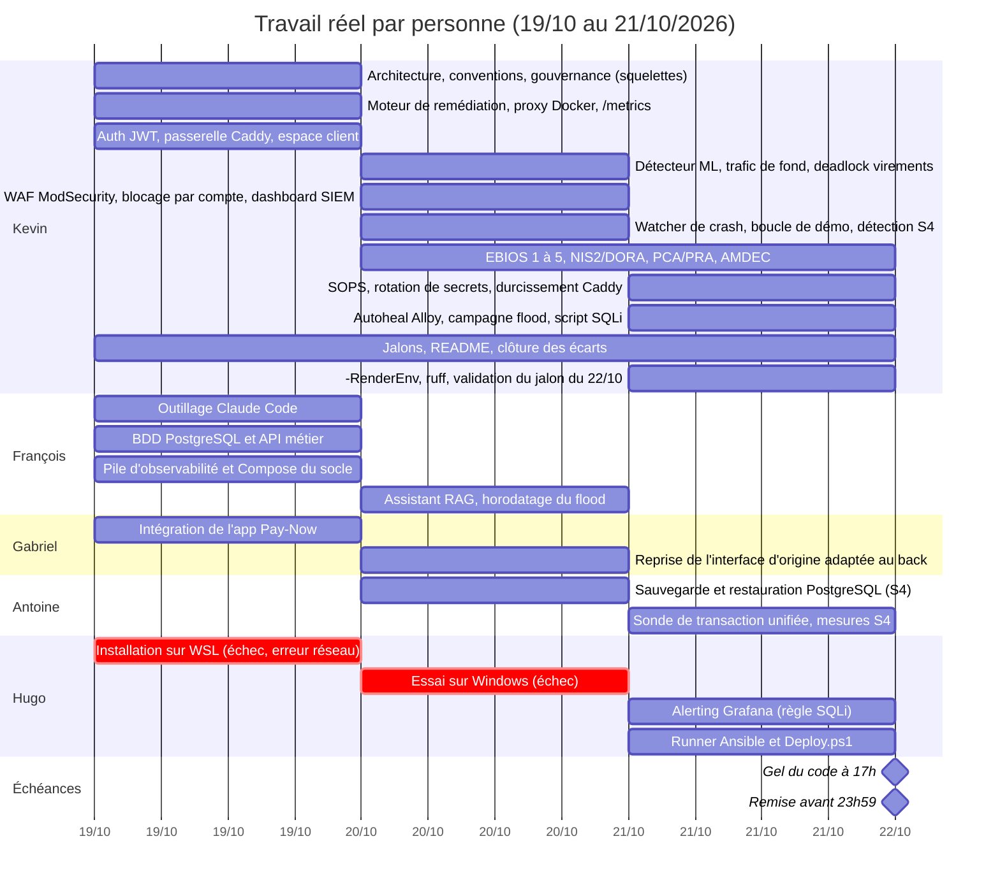

# Répartition réelle du travail (d'après l'historique Git)

Établie le 21/10/2026 puis mise à jour après le dernier commit (jalon du 22/10), à partir de `git log --all` (183 commits, 66 PR) et des diffs par commit et par PR.
Elle montre ce qui a été **réellement livré**, pas ce que prévoyait le debrief.

## 1. Identités Git

| Personne | Identités Git / GitHub | Commits (hors merges) | PR ouvertes |
|---|---|---|---|
| Kevin | `MrSuricate` / `Kevin Ferraretto` (`MrSuricate2` sur GitHub) | 101 | 54 sur 66 |
| François | `francois` (`Francoistlb` sur GitHub) | 18 | 4 (#7, #8, #9, #30) |
| Antoine | `eosiswastaken` (« eosis » sur GitHub) | 5 | 4 (#31, #36, #41, #42) |
| Gabriel | `GabYan876` | 1 | 2 (#4, #21) |
| Hugo | `Hugo Pécal` (`Hogupeck` sur GitHub) | 2 | 2 (#55, #62) |

- Les 55 commits de merge « Kevin Ferraretto » sont des merges de PR faits par le tech lead. Ils ne comptent pas comme travail de contenu.

## 2. Tableau de répartition réelle

| Périmètre | Qui a livré | Preuves (PR / commits) | Volume approximatif |
|---|---|---|---|
| Architecture, conventions, CONTRIBUTING, hook pre-push | Kevin | #2, #5, #6 | ~1 500 lignes |
| Moteur de remédiation (pipeline, actions, politique, vérificateur, proxy Docker, `/metrics`, `/incidents`, watcher de crash, blocage par compte, rotation de secrets) | Kevin | #2, #11, #12, #14, #15, #23, #50 | ~2 300 lignes + 103 fichiers |
| Détecteur ML (IsolationForest), jeu de données, trafic de fond, mesure des faux positifs | Kevin | #17, #18, #33, #43 | ~2 000 lignes |
| Service d'authentification (JWT), passerelle Caddy | Kevin | `f493305`, `c15fbe8`, `ceb6fda` | ~930 lignes |
| WAF ModSecurity + CRS, dashboard SIEM, durcissement Caddy, logs d'audit WAF dans Loki, Grafana via le WAF | Kevin | #22, #51, #57 | ~1 200 lignes |
| Corrections de l'API métier (deadlock des virements, `/me`, `/metrics` auth, montant) | Kevin | #19, `28c5af5`, #53 | ~800 lignes |
| Boucle de démo rejouable, campagne de 5 passages de flood, auto-guérison d'Alloy | Kevin | #23, #37, #61 | ~500 lignes |
| Script d'attaque SQLi (ER2), flood (horodatage de début) | Kevin (SQLi, #45), François (flood, `0e44b59`) | #45 | ~350 lignes |
| Gouvernance : EBIOS RM ateliers 1 à 5, PCA/PRA, NIS2/DORA, AMDEC, matrice de traçabilité, registre des arbitrages | Kevin (rédaction), Antoine (retouches mineures) | #1, #3, #27, #28 | ~660 lignes, 55 fichiers |
| Documentation : README, architecture, jalons 19/10, 20/10, 21/10, procédures | Kevin (très majoritaire), François (architecture de l'observabilité, `docs/dev.md`) | #10, #13, #24 à #29, #32, #44 à #49, #52, #56, #58 à #60 | ~1 200 lignes |
| Socle PostgreSQL, migrations Alembic, API métier de transactions (domaine, cas d'usage, adaptateurs, tests) | François | #8 (`17e02e0`, `66d3735`, `29868be`, `8d978ac`) | ~2 900 lignes |
| Pile d'observabilité (Prometheus, Loki, Alloy, Grafana), dashboard provisionné, Compose du socle, scripts de démo | François | #9 (`6a1ffe1`, `f404434`, `0aae393`, `dd72429`) | ~1 700 lignes |
| Outillage Claude Code partagé (plugins, MCP context7, hook rtk) | François | #7 | ~240 lignes |
| Assistant RAG isolé (LangChain + Ollama) et doc de segmentation | François | #30 (`a13beef`, `045eb0c`) | ~1 270 lignes |
| Sauvegarde et restauration PostgreSQL (S4), sonde de transaction unifiée | Antoine | #31, #36 (`eff6f01`, `6fdacca`) | ~930 lignes |
| Mesures RTO/RPO de S4 sur pile complète, restauration à froid | Antoine | #41, #42 | docs |
| Détection automatique de la corruption de la base (S4 Zero-Touch) | Kevin | `3dbe268`, `9efce59`, `ba2c41b` | ~600 lignes |
| Front de paiement Pay-Now (interface d'origine adaptée au back) | Gabriel | #4, #21 | ~9 200 lignes ajoutées |
| Front : déplacement vers `frontend/`, session conservée, retrait des scripts tiers | Kevin | #16, `c1a7a4c`, `ac44f35` | ~400 lignes |
| Dashboard Grafana provisionné (création) puis validation | Création : François (#9). Validation : consignée par Kevin comme faite par Gabriel, sans trace Git de Gabriel | #9, #53, #54, #60 | docs |
| Alerting Grafana (règle d'alerte SQLi) | Hugo | #55 (`bcf2d08`) | 64 lignes |
| Documentation de la règle d'alerte, arbitrage SOC (Loki/Grafana seuls) | Kevin, arbitrage confirmé par Hugo | #56, `a038d6c` | docs |
| Secrets : `.sops.yaml`, `infra/secrets`, rotation | Kevin | #50 | ~130 lignes |
| Essais d'installation de la pile : lundi 19/10 sur WSL (échec, erreur réseau), mardi 20/10 sur Windows (échec), mercredi 21/10 réussi | Hugo | Déclaré par l'équipe, **aucune trace Git** (travail d'environnement) | n/a |
| Runner Ansible, commande de déploiement unique (`Deploy.ps1`), rôles preflight/application/observability/verify | Hugo | #62 (`f285f48`) | ~440 lignes, 14 fichiers |
| Option `-RenderEnv` de `Deploy.ps1` (rendu du `.env` depuis SOPS) | Kevin | #63 (`55b5cdb`) | ~35 lignes |
| Formatage `ruff` du dépôt, validation du jalon du 22/10 | Kevin | #65, #66 | 10 fichiers + 77 lignes de doc |

## 3. Part de chacun (lignes ajoutées, hors merges)

| Personne | Lignes ajoutées | Part du code applicatif et infra | Remarque |
|---|---|---|---|
| Kevin | ~17 600 | ~65 % | `-5 114` lignes côté front sont un déplacement de dossier, pas une suppression de contenu |
| Gabriel | ~9 200 | front uniquement | Un seul commit, qui importe l'application Pay-Now |
| François | ~6 200 | BDD, API, observabilité, RAG, outillage | 18 commits |
| Antoine | ~1 000 | sauvegarde BDD, sonde | 5 commits |
| Hugo | ~510 | alerting Grafana, Ansible | 2 commits |

Le compte de lignes surestime le front de Gabriel : l'application Pay-Now d'origine est importée telle quelle, puis adaptée. Il mesure la quantité de texte, pas l'effort ni la difficulté.

## 3 bis. Diagramme de Gantt (travail réellement commité)

Les dates sont celles des commits et des merges de PR, à la journée près. Les deux barres rouges de Hugo (essais d'installation ratés) sont déclarées par l'équipe et absentes de Git. Chaque barre va du premier au dernier commit du lot, sans refléter le temps passé dessus. Le diagramme s'affiche sur GitHub et dans les éditeurs compatibles Mermaid.

Lecture : Kevin occupe les trois jours sans interruption, François travaille surtout le 19/10, Gabriel et Antoine n'apparaissent qu'à partir du 20/10 ou du 21/10, et la dernière ligne droite (jeudi 22/10) repose encore presque entièrement sur Kevin.

## 4. Écarts avec la répartition prévue (`CLAUDE.md`)

| Rôle prévu | Prévu | Constaté dans Git |
|---|---|---|
| Hugo : Infra + Cyber (Compose, Ansible, Prom/Grafana/Loki, WAF, SIEM, Vault/SOPS, durcissement, réseau) | Tout le périmètre infra et cyber | 2 commits : alerting Grafana et runner Ansible avec `Deploy.ps1`. Les 19 et 20/10 ont été consacrés à des essais d'installation qui ont échoué (WSL puis Windows), d'où l'absence de commits avant le 21/10 ; l'installation a réussi le 21/10 et Hugo a pu avancer. Le WAF, le SIEM, le durcissement, SOPS et le Compose ont été faits par Kevin ; l'observabilité par François. |
| Kevin : tech lead + remédiation | Architecture, remédiation, ML, intégration | Conforme, mais Kevin a aussi porté l'infra, la cyber, l'auth, la gouvernance et la doc. |
| Antoine : backend, BDD, API, auth, vérification de transaction, EBIOS, PCA/PRA | Backend + gouvernance | Commits sous `eosiswastaken` : sonde de transaction, sauvegarde et restauration BDD, mesures S4. BDD et API livrées par François ; auth, EBIOS et PCA/PRA par Kevin. |
| Gabriel : front, Clip Chrono, Grafana, NIS2/DORA, pitch, Pres.pptx | Front + gouvernance + rendus | Front livré. NIS2/DORA rédigé par Kevin. Aucun commit sur le pitch ou la présentation (ces fichiers ne sont pas dans Git). |
| François : RAG + Red Team | RAG, scripts d'attaque, chaos, Dossier PDF | RAG livré. Il a aussi fait BDD, API et observabilité. Le script SQLi a été écrit par Kevin. |

## 5. Points d'attention avant le gel du code (jeudi 17h)

- **Charge concentrée sur une personne** : environ deux tiers du code et presque toute la gouvernance viennent de Kevin. Le jury demande que chacun explique le code qu'il présente.
- **Preuves de contribution** : les rendus (Dossier PDF, Pres.pptx, clip) ne sont pas versionnés, donc cette analyse ne les couvre pas.

## 7. Répartition de la consigne additionnelle 1 (prévisionnelle, 22/10)

La répartition ci-dessous est **prévisionnelle** ; seul le lot de Kevin (L1 machine à états, L2 agent hôte) est livré, et l'état réel avec ses preuves figure dans le tableau « Avancement et preuves » plus bas. Les autres lignes restent des prévisions, pas des preuves. Conception : [`consigne-additionnelle-1.md`](consigne-additionnelle-1.md). Elle est à valider par l'équipe ; l'historique ci-dessus (§5) montre que Kevin porte déjà la majorité du code, donc le code neuf est réparti sur les autres, Kevin ne gardant que la machine à états, l'agent caméra, l'intégration et les revues. Variante du 22/10 : Antoine prend l'IoT (L3) à sa demande, Hugo reprend la persistance (L1) et les documents EBIOS/AMDEC/PCA.

Échéances : **J0** = avant le gel (si maintenu, jeudi 17h), **J1** = après arbitrage du calendrier (à confirmer auprès de l'enseignant, voir `validation-jalon-22-10.md` §0bis). Tout se fait sur branche, une PR par lot, relue par Kevin.

| Qui | Lot | Tâches | Livrable vérifiable | Échéance |
|---|---|---|---|---|
| Hugo | L1 (persistance) + L3 (réseau) | 1. Tables `roles`, `face_templates`, `login_lockouts` (migration Alembic) et adaptateur `PostgresLockoutStore`, testés. 2. WiFi du point d'accès pour l'ESP8266 et pare-feu : l'ESP n'accepte que l'IP du PC Hôte. 3. Lancement de l'agent caméra par `Deploy.ps1`, avec Kevin | Migration rejouable à froid ; blocage conservé après redémarrage de `auth` ; ESP8266 joignable depuis le PC Hôte seulement | J0 (tables), J1 (réseau, déploiement) |
| Kevin | L1 (machine à états) + L2 | 1. Machine à états d'authentification dans `application/` (identifiant → visage → mot de passe, 2 échecs → blocage 5 min par identifiant), ports `FaceVerifier`, `CameraControl`, `StatusLed`, `LockoutStore` + fakes, tests `pytest`. 2. Agent hôte natif `host-agent/camera` : ouverture/fermeture de la caméra, détection et comparaison (YuNet + SFace), API locale à jeton. 3. Mesure du seuil de similarité sur les membres consentants et de la RAM de l'agent | Scénarios de la table de la LED verts avec des fakes ; un visage enrôlé reconnu, un autre rejeté, caméra éteinte après décision ; chiffres du seuil | J0 (états + reconnu/rejeté), J1 (mesures) |
| Antoine | L3 (firmware) | 1. Firmware `firmware/esp8266-led/` (CLion + PlatformIO) : client WiFi, `POST /led` à jeton, durées dans le firmware (rouge fixe 30 s, vert fixe 30 s, rouge ×10). 2. Câblage de la LED bicolore et résistances, test sur banc. 3. README du service `auth` (réclamé au §0 du jalon). Aide de Hugo pour le WiFi | LED qui suit chaque état de la table, y compris après coupure réseau ; photo ou vidéo du banc | J0 (WiFi + 2 couleurs), J1 (tous les modes) |
| Gabriel | L4 | 1. Page `/admin` dans le front (React + Tailwind) : comptes, rôles, enrôlement et révocation d'un visage, déblocage d'un identifiant, journal d'accès. 2. Parcours de connexion du back-office (saisie identifiant, retour visuel de la caméra, saisie du mot de passe). 3. Panneau Grafana des événements `auth.*` | Parcours complet utilisable avec les fakes, puis avec l'agent | J1 |
| François | L5 | 1. Scripts d'attaque `attack/` : force brute sur l'identifiant, présentation d'une photo, coupure de la caméra/de l'ESP8266 (garde-fous `ALLOWED_HOSTS`, depuis le PC Attaquant seulement). 2. Scénario de chaos correspondant et critères de reprise. 3. Rapport honnête : l'usurpation par photo réussit-elle ? | Journal d'attaque avec résultats réels, y compris les échecs de la défense | J1 |
| Gabriel + Hugo | L6 | Gabriel : NIS2/DORA, Dossier PDF, Pres.pptx, pitch. Hugo : EBIOS (ER7/ER8, SS6, SO3), AMDEC, matrice, PCA (mode dégradé si caméra ou ESP en panne), mis à jour **avec les résultats réels** | Plus aucune ligne « À FAIRE » sans responsable ; aucune ligne « PROUVÉ » sans essai | J1 |
| Kevin | Transverse | Arbitrage du gel, revue de chaque PR (SOLID, pas de logique dans les routes), `pytest` et `scripts/demo_loop.py --runs 5` verts avant chaque merge, mise à jour de ce tableau avec les preuves | `main` stable | en continu |

### Avancement et preuves (22/10)

Mis à jour par Kevin après le merge de la PR #72 (`fd95d3b`, commits `e4f71fb` et `ccd0d42`). Complété le 22/10 après la PR #75 (`2430ebc`) et un premier essai sur la caméra intégrée du PC de Kevin. Seul ce qui a été exécuté est marqué « prouvé » ; tout le reste est dit non prouvé.

| Lot | Responsable | État | Preuve (commande ou constat) | Non prouvé / reste à faire |
|---|---|---|---|---|
| L1 machine à états | Kevin | **Livré** (PR #72) | `pytest` de `services/auth` : 39 tests verts (hors `test_metrics.py`, dépendance absente du venv local), `ruff` et `black` propres. Les scénarios de la table de la LED, le blocage 2 échecs / 5 min, la libération après 5 min, la remise à zéro après succès, l'usage unique de la reconnaissance et l'échec fermé sont couverts avec des fakes | Le test avec une vraie caméra |
| Routes et câblage `auth` | Kevin | **Livré** (PR #72) | Image `auth` reconstruite, conteneur sain. Sans agent configuré : `POST /auth/admin/identify` → 503, `POST /auth/admin/login` sans visage → 403 ; le parcours client reste à 401 sur un mauvais mot de passe. `docker compose config` valide avec le `.env` | Avec l'agent et un visage enrôlé (essai du 22/10, via le WAF) : parcours nominal `identify` 200 puis `login` 200 ; mauvais mot de passe 401, puis 403 tant que le visage n'est pas revérifié ; deux échecs, puis `identify` → 423 avec `Retry-After: 300`. Événements `auth.*` présents dans Loki | Le blocage reste en mémoire (voir L1 persistance) ; cas « agent arrêté » rejoué le 22/10 via le WAF : `identify` → 503, `login` → 403 (échec fermé) |
| L2 agent hôte | Kevin | **Livré, essayé sur la caméra intégrée** (PR #72) | Agent : 21 tests verts, dont un test de fumée sur les vrais modèles ONNX. Démarrage réel sur le port 8765 : 401 sans jeton, 503 sans caméra (échec fermé). Essai du 22/10 sur la **caméra USB** (UGREEN) : gabarit enrôlé sur la caméra intégrée, réutilisé tel quel. Similarité du membre enrôlé : 10 mesures, min 0,752, moyenne 0,786, max 0,806. Un autre membre consentant (1 personne, 10 mesures) : min 0,023, moyenne 0,060, max 0,094. Seuil 0,363 entre les deux groupes, conservé. Agent réel : 401 sans jeton, 503 caméra éteinte, `verify` → `match: true` puis `false` pour un identifiant sans gabarit, 503 après `camera/stop`. RAM de l'agent caméra allumée : environ 198 Mo (working set) | Mesure faite sur **1 seul imposteur** et 10 images, une caméra, une lumière : pas un taux d'erreur ; voyant de la caméra non constaté ; aucune détection de vivacité |
| Non-régression du fil rouge | Kevin | **Prouvé** | `scripts/demo_loop.py --runs 5` : avant le merge, 5/5 reprises automatiques, RTO moyen 39 s, max 44 s ; après le merge sur `main`, 5/5, RTO moyen 39 s, max 41 s ; transaction de test réussie à chaque passage. Rejoué le 22/10 après le merge des PR #77/#78 : 5/5, RTO moyen 32 s, max 36 s, transaction réussie à chaque passage. Rejoué une nouvelle fois le 22/10 (10:35) après le merge des PR #79/#80/#81 : 5/5, RTO moyen 32 s, max 35 s, transaction réussie à chaque passage — critère de sortie du jalon du 22/10 (§7 de `validation-jalon-22-10.md`) atteint | |
| RAG sur Ollama distant | Kevin (vérification) | **Prouvé** | `OLLAMA_URL=http://192.168.137.157:11434` : `llama3.1:8b` (8,0 B) et `nomic-embed-text` présents ; depuis le conteneur `rag-assistant`, `/ask` → 200 avec 5 sources (13,8 s), sans jeton → 401 | Pare-feu du PC Ollama (n'accepter que `192.168.137.1`) non vérifié |
| L1 persistance | Hugo | À faire | Aucune. Le blocage est **en mémoire** (perdu au redémarrage de `auth`) en attendant `PostgresLockoutStore` | Tables, migration, adaptateur, test de redémarrage |
| L3 réseau et déploiement | Hugo | À faire | Aucune. `Deploy.ps1` ne lance pas encore l'agent (`host-agent/camera/run.ps1` existe et relit désormais le jeton dans le `.env`) ; `render_env.sh` génère `HOST_AGENT_URL` et `HOST_AGENT_TOKEN` | WiFi de l'ESP8266, pare-feu, lancement de l'agent |
| L3 firmware | Antoine | **Écrit, non essayé** (PR #87) | `firmware/esp8266-led/` (PlatformIO, D1 mini) : `POST /led` signé HMAC-SHA256 (compteur anti-rejeu) et filtre sur l'IP du PC Hôte, 5 modes, durées dans le firmware ; README avec contrat et câblage. Le premier jet de la PR (serveur Flask + ESP32 en série USB, `services/webserver/`) a été remplacé car hors contrat | Compilation (`pio run`), flash, câblage, essai sur banc des 5 modes et de la coupure réseau, photo ou vidéo |
| L4 page `/admin` | Kevin (pour Gabriel) | **Livré en partie** (PR #75, `2430ebc`) | `tsc -b` propre. Page `/admin` (identifiant, visage, mot de passe ; messages 403, 503, 401 ; compte à rebours 423) servie par Vite et jouée contre le vrai back. Section « Authentification du back-office » ajoutée au dashboard (6 compteurs, journal) : les 6 événements attendus sont comptés dans Loki | Page vue seulement en développement, aucun test automatisé du front ; panneau « caméra ou agent indisponible » non déclenché ; habilitations, enrôlement et écran back-office après connexion (la page renvoie vers `/home`) ; relecture Gabriel |
| L5 attaques | François | À faire | Aucune | Force brute, photo, coupure caméra / ESP8266, chaos |
| L6 gouvernance | Hugo + Gabriel | À faire | Aucune | EBIOS, AMDEC, matrice, PCA, NIS2/DORA avec les résultats réels |

Écarts connus à signaler au jury : rôles et habilitations non implémentés (tout compte avec gabarit et mot de passe valides obtient un jeton), pas de détection de vivacité, blocage non persistant.

Ordre : L1 et L3 démarrent en parallèle (aucune dépendance matérielle croisée), L2 dès que la caméra est sur le PC Hôte, L4 après le contrat d'API de L1, L5 et L6 en dernier.

Chacun doit pouvoir expliquer son lot devant le jury, code généré par IA compris (règle du dépôt).

## 6. Méthode et limites

- Sources : `git log --all --numstat`, `git shortlog`, `gh pr list` (auteur de chaque PR).
- Un commit ou une PR est attribué·e à son auteur Git. Le travail fait à plusieurs sur un même poste, ou commité par une autre personne, n'apparaît pas.
- Les volumes de lignes sont approximatifs et incluent les tests, la documentation et les fichiers générés.
- Les lignes ne mesurent ni la difficulté ni l'effort de conception.
